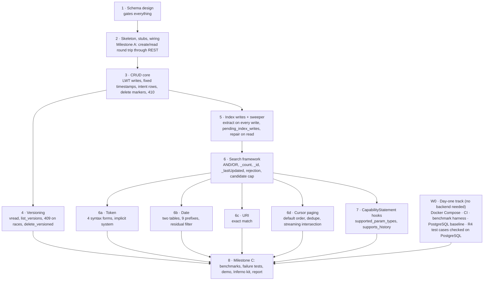

# Development Roadmap: Cassandra Backend for Helios

Alan Cruz, Anastasia Bryzgalova, Diya Subhashbhai Patel, Sara Lahourpour, Samuel Michaels Rodriguez · Draft, October 2026

This roadmap turns the design in `cassandra-discussion.md` into ordered work with exit criteria. The design document owns the *what* and the *why*; this one owns the *in what order*, *by whom*, and *how we know a step is done*. Where the two disagree, the design document wins and this file is updated. Baseline revision: `a5e74a3604b181722a2d02b11f29cc76e91520bd`.

## 1. Ground rules

- **Every step has an exit criterion that a script or a test can check.** "Done" means the criterion passes on CI, not that the code exists.
- **The trait hierarchy sets the order.** `VersionedStorage` and `SearchProvider` both extend `ResourceStorage`, so CRUD lands before vread or search. Every table depends on the schema, so the schema is designed and signed off before any backend code.
- **Nothing is R4-specific.** No `FhirVersion::R4` literal outside tests; defaults come from `FhirVersion::default_enabled()` and the backend config. CI compiles the crate in an R4B-only build from the first skeleton onward.
- **One owner per shared file.** `backends/mod.rs`, `lib.rs`, the persistence, rest and hfs `Cargo.toml` files, `crates/rest/src/config.rs` and `crates/hfs/src/main.rs` are edited by one person. Everyone else works in `crates/persistence/src/backends/cassandra/` and in their own file there.
- **Measure before optimizing.** The partition-bucketing and tombstone decisions in the design are measure-first. Nobody adds a bucket until a trigger in section 7 fires.
- **Upstream-shaped from day one.** Commits are small, the CapabilityStatement patch is kept separable, and no change outside `backends/cassandra/` is made without a line in section 8's "upstream touch list".
- **Track upstream weekly.** The baseline hash is pinned for the report, but the code is not frozen: upstream changed 103 files under `persistence` and `rest` between the baseline and today. Every Sunday Alan (`aacruzgon`) merges `upstream/main` into `main` on a `sync/upstream-YYYY-MM-DD` branch (the naming already used in this fork), and CI must pass on that branch before it merges. Between syncs, the upstream canary (`.github/workflows/upstream-canary.yml`, ADR-sam-michaels-0005) does a dry-run merge nightly at 02:00 UTC and keeps an "upstream drift" issue open while the merge conflicts or 0.4's check fails, so a new required trait method is found the day it lands, not the day of a demo, and the Sunday sync starts from a known state. Before the sync branch merges, any file it adds under `.github/workflows/` is moved to `.github/disabled-workflows/`. No upstream workflow carries the fork guard, and upstream uses actions by tag or branch, which the repository's SHA-pin setting fails before any step runs. Many upstream jobs also run on `[self-hosted, Linux]`, which our runners match, so those would run on our machines (ADR-aacruzgon-0022).
- **Heavy checks run on CI, not on laptops.** The workspace compiles all FHIR models; `cargo clippy --all-targets --all-features` is a CI-only job, run with the exact flags in `CONTRIBUTING.md`. Locally, developers run `cargo check -p helios-persistence --features cassandra` and the Cassandra test binary; `cargo fmt --all` is cheap and runs everywhere. Pull requests merge only when the required CI checks are green: the R4B compile check (item 0.4) and item 0.5's four jobs, `cargo fmt --check`, `cargo clippy (helios-fhir)`, `cargo clippy (workspace)` and `Cassandra schema (single node)` (ADR-aacruzgon-0021). Commits do not use `[skip ci]`, because a required check that is skipped never reports and blocks the pull request (ADR-aacruzgon-0019).
- **Machines.** Two Apple-silicon laptops with 16 GB, two with 18 GB, one Apple-silicon machine with 32 GB, and one Windows machine with 32 GB. None of them runs CI: every workflow this project adds runs on the team's two self-hosted GitHub Actions runners (ADR-aacruzgon-0018). `sam-7900x` is Sam's own desktop with 32 GB and an AMD 7900X CPU, which he also develops on (ADR-sam-michaels-0001); it takes every job, light and heavy. `acruzdebian` is Alan's Debian 13 desktop with 15 GB and an AMD Ryzen 7 5800X CPU; it takes light jobs only, because the clippy pair peaks at 14.8 and 17.3 GiB (ADR-aacruzgon-0023). Single-node Cassandra runs everywhere with `MAX_HEAP_SIZE=1G` on the 16 and 18 GB machines and `2G` on the 32 GB machines; the three-node cluster (three JVMs) runs only on the two 32 GB machines. Benchmarks that go in the report run on one designated 32 GB machine so numbers are comparable. The Windows machine follows the worktree and `nul` notes in `CLAUDE.md` and uses Docker Desktop with WSL 2 for the containers.

## 2. Workstreams and dependencies

Five workstreams. The first three are strictly ordered; the last two start on day one and merge at the end.

**Parallelism.** Steps 1 and 2 are whole-team or single-owner. From step 3 onward two people can work (CRUD core and the day-one track). From step 6 onward four people work at once on 6a to 6d and 7, each in its own file. Step 8 needs everything.

## 3. Milestones

| Milestone | What passes | Gate |
| --- | --- | --- |
| **A. Round trip** | `HFS_STORAGE_BACKEND=cassandra` starts Helios against a local Cassandra; `POST /Patient` then `GET /Patient/{id}` returns the resource with `meta.versionId = "1"` and `ETag: W/"1"`. | Step 2 |
| **B. Correct** | CRUD, versioning, the three search types, cursor paging and rejection pass the shared suites listed in section 5 on a single node; the failure tests in section 6 pass; the R4B compile check passes. | Steps 3 to 7 |
| **C. Measured and shown** | Benchmarks run on both backends with raw results committed; the scripted demonstration passes every step on Cassandra and on PostgreSQL; the report is drafted. | Step 8 |

### Progress matrix

One row per checkable item, grouped by step; the milestone column says which gate it feeds. Update the row in the same commit that completes the item, and put the pull request or commit in the evidence column. Status: ☐ not started · ◐ in progress · ✅ done. Owner codes are the ones used in section 4 (**W** wiring owner, **A** to **E** as suggested there); **X** means not assigned yet: the group decides.

| # | Item | Milestone | Owner | Status | Date | Evidence |
| --- | --- | --- | --- | --- | --- | --- |
| 0.1 | Single-node Compose file: Cassandra 5.0.x pinned, `paxos_variant: v2`, explicit heap, CPU/memory limits recorded | A | E | ✅ | 2026-10-13 | `docker/cassandra/` (`cassandra:5.0.9-trixie` by digest, `cassandra_latest.yaml`; 4 CPUs; 1G heap / 3 GiB, or 2G / 5 GiB via `docker-compose.heap2g.yml`); `system_views.settings` shows `paxos_variant = v2`; ADR-aacruzgon-0001 to 0003; first version in `1a0bb61bd`; PR #9; also verified on the Windows machine (Docker Desktop + WSL 2, `core.autocrlf=true`; `entrypoint.sh` checked out LF, first boot 67 s), issue #10 |
| 0.2 | PostgreSQL Compose file with the same limits, `synchronous_commit` recorded | A | E | ✅ | 2026-10-13 | `docker/postgres/` (`postgres:18.6-trixie` by digest; 4 CPUs; 3 GiB, or 5 GiB via `docker-compose.mem5g.yml`; `synchronous_commit = on`, `off` via `docker-compose.async.yml`); `pg_settings` shows each value from the command line; ADR-aacruzgon-0004 to 0007; PR #11 |
| 0.3 | Three-node Compose cluster: RF 3, `GossipingPropertyFileSnitch`, DC name matching the keyspace | B | E | ☐ | | |
| 0.4 | CI: `cargo check -p helios-persistence --no-default-features --features cassandra,R4B` | A | E | ✅ | 2026-10-14 | `.github/workflows/r4b-compile-check.yml` on `[self-hosted, hfs-cassandra]` (`hfs-cassandra-light` since ADR-aacruzgon-0023; actions pinned by SHA, fork guard, `contents: read`); persistent per-job target directory, wiped when the toolchain or `Cargo.lock` changes or past a 10 GB cap (ADR-sam-michaels-0002); green on PR #17, run 38630825279: cold `cargo check` 66 s (whole job 69 s), warm 1 s (whole job 3 s); PR #17 |
| 0.5 | CI: fmt check, the `CONTRIBUTING.md` clippy job with `-D warnings`, a persistent per-job target directory (ADR-sam-michaels-0002), and the Cassandra test job against the single-node container | B | E | ✅ | 2026-10-15 | `.github/workflows/fmt-clippy-cassandra.yml`: `cargo fmt --check`; clippy split into `cargo clippy (helios-fhir)` (1 job) and `cargo clippy (workspace)` (8 jobs, `needs:` the first), which together lint the `CONTRIBUTING.md` command's crates and targets under the runner's 20 GB memory cap; `Cassandra schema (single node)` on `127.0.0.1:59142`, which since Step 3 also runs the backend's `--lib` tests (ADR-aacruzgon-0054); plus the weekly `runner-docker-prune.yml` (ADR-sam-michaels-0003, 0004). Green on PR #20, run 38672131127: cold clippy 4 min 57 s + 3 min 42 s (peaks 14.8 and 17.3 GiB), warm 6 s + 15 s; Cassandra 69 s; fmt 10 s; PR #20 |
| 0.6 | Benchmark harness: open-loop load, warm-up, three runs, CSV output, 409 separated from 5xx; LWT throughput measured at steady state and peak container memory logged on long runs (ADR-aacruzgon-0001, 0002) | C | E | ☐ | | |
| 0.7 | Synthea datasets (fixed seed, Patient and Observation) for 10,000 and 100,000 resources; version, seed, modules and checksums recorded; generation script committed | C | E | ☐ | | |
| 0.8 | PostgreSQL baseline CSVs for both dataset sizes; decide whether the `synchronous_commit = off` baseline (`docker/postgres/docker-compose.async.yml`) is run too, and label every number with its baseline (ADR-aacruzgon-0005) | C | E | ☐ | | |
| 0.9 | Demonstration script written and passing against PostgreSQL | C | E | ☐ | | |
| 0.10 | Cassandra spike done and write-up in `docs/Cassandra/`, read before the schema session | A | A | ✅ | 2026-10-13 | PR #12: `docs/Cassandra/spike-findings.md` with transcripts and traces in `docs/Cassandra/spike/`; every listed experiment plus LWT durability under `kill -9`; all design assumptions held, and six points for the schema session |
| 0.11 | Upstream canary workflow scheduled and has run once; weekly `sync/upstream-*` merge in place | A | E | ✅ | 2026-10-15 | `.github/workflows/upstream-canary.yml`, nightly at 02:00 UTC (ADR-sam-michaels-0005); PR #22. Run on `main` by hand: run 38798726307 green (upstream `8aada6230`, 202 commits ahead, merges cleanly; cold check 62 s), run 38799140457 with `test_report` opened issue #23, run 38799415655 closed it; no `canary/*` branch pushed. Weekly sync: Alan, every Sunday ("Track upstream weekly") |
| 1.1 | `schema.cql` applies cleanly to a fresh node; every checklist item in Step 1 decided and recorded | A | W | ◐ | 2026-11-06 | PR #33 (merge `67f9e0532`): the `Cassandra schema (single node)` check applies it to a fresh node and matches `expected-schema.txt` (92 rows); every checklist item decided in ADR-aacruzgon-0008 to 0017 and 0024 to 0027. Done when 1.4 is |
| 1.2 | Paper walk-through of every in-scope operation and the sweeper path | A | all | ◐ | 2026-11-06 | PR #33 (merge `67f9e0532`): `schema/walkthrough.md`. Done when 1.4 is |
| 1.3 | Query coverage table in the repo | A | all | ◐ | 2026-11-06 | PR #33 (merge `67f9e0532`): `schema/coverage.md`. Done when 1.4 is |
| 1.4 | Every member's sign-off on `schema.cql` recorded in their ADR log | A | all | ◐ | 2026-11-06 | 1 of 5, against `67f9e0532`: ADR-aacruzgon-0028 (Alan). To record: `ADR-anastasiabryz`, `ADR-diya-patel83`, `ADR-sam-michaels`, `ADR-sara-lahourpour` |
| 2.0 | Cassandra test node: `HFS_TEST_CASSANDRA_URL` when set, otherwise a `GenericImage` test container in `tests/common/` with CQL readiness wait and cleanup hook (ADR-aacruzgon-0020) | A | A | ✅ | 2026-11-06 | `crates/persistence/tests/common/cassandra.rs`: `HFS_TEST_CASSANDRA_URL` as `host:port`, never DDL there; otherwise `cassandra:5.0.9-trixie` by digest as a `GenericImage`, a `SELECT` retried until the node answers, the schema applied once, `#[ctor::dtor]` cleanup; the `tests/cassandra_tests.rs` binary, built before the node starts in `Cassandra schema (single node)` (ADR-aacruzgon-0029, 0030); cold test build peaks 4,817 MiB on `acruzdebian`, so the job stays light; PR #36 (merge `fb16da9d1`). 68 tests pass on `main`, run 42306779329 |
| 2.1 | `backends/cassandra/` skeleton compiles; stubs for the 12 bound traits; listed defaults overridden; first `cdrs-tokio` connection from the host to `docker/cassandra` confirmed (the node advertises its container IP; fix in that README) | A | A | ✅ | 2026-11-06 | `crates/persistence/src/backends/cassandra/` on `cdrs-tokio` 10.0.0; `create`, `read` and `count` real, every other method of `create_app`'s 12 bound traits 501 `UnsupportedCapability` (`stubs.rs`); `readiness_check`, `is_cluster_shared`, `bulk_write_concurrency`, `supports_conditional` overridden; ADR-aacruzgon-0031 to 0035, 0044; PRs #37 (merge `2d99cffa2`), #38 (`c05835278`), #45 (`0d20dd67f`). Host connection: the driver keeps the contact point, so `127.0.0.1:59042` works without `CASSANDRA_BROADCAST_RPC_ADDRESS` (`docker/cassandra/README.md`, from #36), checked in `cassandra_tests` |
| 2.2 | `cassandra` feature threaded through rest and hfs; `StorageBackendMode::Cassandra`; `start_cassandra`; `patient_name_search_support` arm; feature fallback | A | W | ✅ | 2026-11-06 | `crates/rest/Cargo.toml`, `crates/hfs/Cargo.toml` (`cassandra` feature); `StorageBackendMode::Cassandra` in `crates/rest/src/config.rs`; `start_cassandra` in `crates/hfs/src/main.rs`, `None` for every store the backend lacks, SQL-on-FHIR off and the database audit sink refused; `patient_name_search_support` `IdOnly`; `#[cfg(not(feature = "cassandra"))]` fallback; ADR-aacruzgon-0040; PR #43 (merge `7e7b520ff`). `hfs` boots on Cassandra in Milestone A, run 42306779329 |
| 2.3 | `TenantSearchRegistries` plumbing and `search_param_registry` | A | A | ✅ | 2026-11-06 | `TenantSearchRegistries` in `backends/cassandra/backend.rs`, `search_param_registry` in `search.rs` (PR #37, merge `2d99cffa2`); every tenant's stored SearchParameters reloaded before serving, startup fails if that fails, and a TTL refresh that continues past a failed tenant (ADR-aacruzgon-0041; PR #43, merge `7e7b520ff`). Load 0.15 to 0.40 s for 7 to 9 tenants in run 42306779329's boot report |
| 2.4 | Cassandra module in `backend_capability_contract.rs`; stale table in `tests/common/capabilities.rs` fixed or removed | A | A | ✅ | 2026-11-06 | `tests/backend_capability_contract.rs` module `cassandra`, golden list `[SharedSchema]` (= `declared_capabilities()`), no conditional interaction; two instance tests that skip without `HFS_TEST_CASSANDRA_URL` (ADR-aacruzgon-0036); the stale row in `tests/common/capabilities.rs` corrected to the design, not removed; each later step declares its capability (ADR-aacruzgon-0037); PRs #41 (merge `292932a26`), #51 (`dcba30b09`). 10 contract tests pass, no skip, in run 42306779329 |
| 2.5 | `TestableBackend` implemented for Cassandra against the Compose single node, each test under its own tenant or ids (ADR-aacruzgon-0020) | A | A | ✅ | 2026-11-06 | `tests/common/cassandra_testable.rs`: `CassandraTestBackend`, capabilities from `declared_capabilities()`, `reset` rotates to fresh tenants and runs no statement (ADR-aacruzgon-0038); `tests/cassandra_tests.rs` compiles the shared `harness.rs`, `fixtures.rs` and `capabilities.rs`, with one fix to `fixtures.rs` (ADR-aacruzgon-0039); PR #42 (merge `dba95cfea`). Against the job's Compose node on `127.0.0.1:59142`, `cassandra_tests` passes 68 in run 42306779329 |
| 2.6 | Conformance-seeder boot time measured and recorded | A | A | ✅ | 2026-11-06 | Seed per fresh tenant 1.3 to 4.5 s by hand (1,372 SearchParameter + 5 CompartmentDefinition; ADR-aacruzgon-0043, PR #44, merge `c6fcb61c9`), under the provisional budget of 10 s of seeding per fresh tenant on the single node, so `create_many` keeps its default. Re-measured on every CI run by `boot_time_report` in `crates/hfs/tests/cassandra_milestone_a.rs` (ADR-aacruzgon-0045; PR #46, merge `30d049967`): run 42306779329 on `sam-7900x`, worst fresh seed 0.86 s, launch to `/metadata` 1.35 to 1.41 s, warm 0.94 s |
| 2.7 | **Milestone A** script passes: create then read through REST, `versionId` 1, `ETag W/"1"`; `/_readiness` down when Cassandra is stopped | A | W | ✅ | 2026-11-06 | `crates/hfs/tests/cassandra_milestone_a.rs` in the required `Cassandra schema (single node)` job (ADR-aacruzgon-0042; PR #44, merge `c6fcb61c9`): `POST /Patient` 201 with `Location` `[base]/Patient/[id]/_history/1`, `ETag: W/"1"`, `meta.versionId` "1", and `GET` 200 with the same (ADR-aacruzgon-0049; PR #52, merge `5de7a7061`). Green on `5de7a7061`, runs 42306779329 and 42306779347 (R4B): `/_readiness` 503 within 4.86 s of `docker stop`, 200 again 25.08 s after `docker start` |
| 3.1 | Six-step write path: intent row, CAS with `write_ts`/`write_id`, versions row, index batches, intent delete | B | A | ☐ | | |
| 3.2 | CAS outcome mapping (404/409 from condition columns; 410 only from `read`/`vread`), timeout and failure handling (`WriteTimeout`/`WriteFailure` with `CAS`, `CAS_WRITE_UNKNOWN`, `SIMPLE`, serial-read timeout; 504 or 503), the `create_or_update` retry loop and the plain-delete retry (ADR-aacruzgon-0024) | B | A | ☐ | | |
| 3.3 | `crud_suite.rs`'s tests, as an adapted copy with a parity test and four Cassandra-strict tests (ADR-aacruzgon-0057), and every test in `search/versioned_write_race_suite.rs` pass, `concurrent_puts_onto_a_tombstone_all_succeed` included | B | A | ✅ | 2026-11-07 | `tests/cassandra/crud.rs`: upstream's 88 CRUD tests on fresh tenants, `crud::parity::crud_copy_matches_upstream` against `tests/crud/` and the four `crud::strict::cassandra_strict_*` tests, 94 in all; the race suite's five wrappers in `tests/cassandra_tests.rs` (`step3_suites`, four on 8 worker threads, 10 rounds), `cassandra_concurrent_puts_onto_a_tombstone_all_succeed` included (ADR-aacruzgon-0057; PR #60). In the required job, run 42401552753: `cassandra_tests` 172/172, every `crud::` and race test passing, no CAS budget run out |
| 3.4 | 410 after delete, 200 after revive; the node's CQL audit log shows no CQL `DELETE` against `resources` or `resource_versions`, checked in the required Cassandra job (ADR-aacruzgon-0058) | B | A | ✅ | 2026-11-07 | `step3_crud_through_rest` in `crates/hfs/tests/cassandra_milestone_a.rs`, through `hfs`: `GET` after `DELETE` 410 (R-3, and D-4 after a second `DELETE`), the marker's vread 410 (V-1), the revive's `PUT` 201 and the `GET` after it 200 (U-14); the step "Check the CQL audit log for a DELETE on resources or resource_versions" (ADR-aacruzgon-0058; PR #60). In the required job, run 42401552753: 109 HL7 rows, 0 mismatches; the audit check passed on 32,652 entries (31,159 DML in `helios`), with no violation |
| 4.1 | `VersionedStorage` real: `vread`, `list_versions` and `delete_with_match` since Step 3 (ADR-aacruzgon-0060), `update_with_match` at Step 4; `versioning_suite.rs` passes, and `search/conditional_if_match_suite.rs` or what replaces it (pending Step 4's ADR: the suite cannot pass on Cassandra, Step 4's handover); `list_versions` numeric order past 9; `Versioning` declared (ADR-aacruzgon-0037) | B | X | ☐ | | |
| 5.1 | Index maintenance on every write with fixed timestamps; every batch under 5 KiB on the fixtures | B | X | ☐ | | |
| 5.2 | Sweeper: 32 partitions polled, grace period, the current version's keys from the `resources` row's `index_keys`, previous keys from row V−1's `index_keys`, which always exists for V > 1 (G40), intent deleted; it never compares `write_id` | B | X | ☐ | | |
| 5.3 | Repair-on-read hook | B | X | ☐ | | |
| 5.4 | Index-versus-fresh-extraction consistency utility passes after any write sequence | B | X | ☐ | | |
| 6.1 | Search framework entry validation and every documented rejection with its status code | B | X | ☐ | | |
| 6.2 | `_id`, `_lastUpdated`, unfiltered type search, `search_count`, `_count=0` | B | X | ☐ | | |
| 6.3 | Streaming AND/OR, dedupe on `(last_updated, id)`, candidate cap (distinct candidates point-read; 422 `TooManyResults`, G27), `next_cursor` always minted | B | X | ☐ | | |
| 6.4 | `search/meta_params_suite.rs` and `total_mode_suite.rs` pass; `large_id_set_suite.rs::large_id_set_search_count_cursor_not_and_tenant` passes up to its `:not` block; the token, date and URI cases of `empty_value_suite.rs` pass as a copy in `tests/cassandra/` (section 5) | B | X | ☐ | | |
| 6a | Token: four forms, implicit system merge, case-sensitive, pipe form on ContactPoint and boolean matched by the general rules (`coverage.md` C4); `token_code_system_suite.rs` passes as a copy in `tests/cassandra/` without its `:not` cases, and without `system_qualified_tokens_in_chains` (section 5) | B | X | ☐ | | |
| 6b | Date: both tables, nine prefixes, residual filter; `date_boundary` and `date_precision` suites pass, and the date-prefix cases of `date_period_suite` pass as a copy in `tests/cassandra/` (section 5); parity with PostgreSQL on the fixtures | B | X | ☐ | | |
| 6c | URI: exact match; coverage-table cases pass; trailing-slash variant does not match | B | X | ☐ | | |
| 6d | Cursor paging: default order, reserved bucket slot, `InvalidCursor`; 100,000 resources paged with no duplicates or gaps | B | X | ☐ | | |
| 6.5 | Multitenancy: a `count_by_tenant` override for the Tenants UI and `/admin/tenants`, from ADR-aacruzgon-0041's partition-key scan. The two CRUD-only suite tests run since Step 3, and the rest are out of scope (section 5, ADR-aacruzgon-0060) | B | X | ☐ | | |
| 7.1 | `supported_param_types` and `supports_history` hooks; handler filters parameters and omits history; existing capabilities tests green for all backends | B | W | ☐ | | |
| 7.2 | `GET /metadata` on Cassandra lists only token, date and URI parameters and no history interactions | B | W | ☐ | | |
| 7.3 | Handler patch opened upstream as its own pull request | C | W | ☐ | | |
| 8.1 | Failure tests in section 6 pass on the single node | B | X | ☐ | | |
| 8.2 | **Milestone B**: all items 2.1 to 8.1 done and CI green | B | W | ☐ | | |
| 8.3 | Failure tests pass on the three-node cluster | C | X | ☐ | | |
| 8.4 | Benchmarks on both backends: raw CSVs, environment record, `nodetool` histograms, tombstones per read | C | X | ☐ | | |
| 8.5 | Measure-first triggers in section 7 evaluated and the outcome recorded | C | X | ☐ | | |
| 8.6 | Demonstration script passes on Cassandra and on PostgreSQL in CI | C | all | ☐ | | |
| 8.7 | Inferno test kit (`utils/inferno-test-kit/`): capability-truth, CRUD and versioning, supported-search and declared-rejection groups; every test passes against Cassandra, in the UI and headless in CI | C | X | ☐ | | |
| 8.8 | The same kit against PostgreSQL: capability-truth, CRUD and supported-search groups pass; the rejection group fails as expected and the contrast is recorded for the report | C | X | ☐ | | |
| 8.9 | One-off US Core v3.1.1 server-suite run against Cassandra, headless, pinned kit version; results JSON kept; every failure mapped to a declared rejection or a CapabilityStatement line | C | X | ☐ | | |
| 8.10 | README Cassandra column and the upstream touch list updated | C | W | ☐ | | |
| 8.11 | Report draft reviewed by all five | C | all | ☐ | | |
| 8.12 | **Milestone C**: all items done; artifacts in section 11 committed with the commit hash | C | all | ☐ | | |

## 4. Steps in detail

Each step lists goal, tasks, exit criterion, and who. "Who" is a suggested split for five people and can be reshuffled; the owner of shared files (called **W** below) does not change mid-project. From Step 4 on, **X** means not assigned yet: the group decides who takes each step and makes that step's decisions, and Alan audits them (ADR-aacruzgon-0060).

Each step also lists **Spec**: the FHIR pages to have open while implementing it. R4 is normative for this project; a build link appears only where the design document's "What the FHIR specification requires" table says the build differs, and that table remains the one-page summary of the rules. Links were checked on 2026-10-13.

Each step also lists **Cassandra docs**: the [Apache Cassandra 5.0 documentation](https://cassandra.apache.org/doc/5.0/index.html) pages to read for it, since we run 5.0.9. Where the docs are silent or vague (what a failed compare-and-swap returns, result order across partitions, outbox tables), [`spike-findings.md`](spike-findings.md) and the schema drafts in [`schema/`](schema/README.md) record what a real node did; check there before guessing. Links were checked on 2026-10-13.

### Step 0 · Day-one track (runs throughout)

**Goal.** Everything that needs no Cassandra code exists before the backend does, so Milestone C is not blocked on tooling.

**Tasks.**
- Cassandra spike, before the schema session: one day, one person, on the single-node Compose file. In `cqlsh`: create a two-table toy schema, run one `INSERT … IF NOT EXISTS` and one conditional `UPDATE`, run one logged batch deliberately over `batch_size_warn_threshold` and read the warning, run `TRACING ON` for a clustering slice and a full-partition scan, delete a few hundred rows and read `nodetool tablestats` to see tombstones, and kill the container mid-batch to watch batchlog replay. Exit: a two-page write-up in `docs/Cassandra/` with the traces, which the schema session reads first.
- Docker Compose for Cassandra 5.0.x (pinned tag) with `paxos_variant: v2`, explicit `MAX_HEAP_SIZE`, `batch_size_warn_threshold`/`fail_threshold` left at defaults, and CPU/memory limits recorded in the file. A second Compose file for a three-node cluster on one host (RF 3, `GossipingPropertyFileSnitch`, one DC name matching the keyspace's `NetworkTopologyStrategy` map). A PostgreSQL Compose file with the same resource limits and its `synchronous_commit` setting recorded.
- CI on the team's self-hosted GitHub Actions runners (ADR-aacruzgon-0018), so every `runs-on` names `[self-hosted, hfs-cassandra-light]` (fmt, the R4B check, the Cassandra job and the canary, on either runner) or `[self-hosted, hfs-cassandra-heavy]` (the two clippy jobs, on `sam-7900x` only; ADR-aacruzgon-0023). `sam-7900x` was registered 2026-10-14: Fedora Linux 44, x86_64, labels `self-hosted, Linux, X64, hfs-cassandra, hfs-cassandra-light, hfs-cassandra-heavy, hfs-runner-sam-7900x`, service capped at 20 GB (ADR-sam-michaels-0001, 0003). `acruzdebian` was registered 2026-11-04: Debian 13, x86_64, labels `self-hosted, Linux, X64, hfs-cassandra-light, hfs-runner-acruzdebian`, service capped at 9 GiB (ADR-aacruzgon-0023). Both run as a systemd service under the non-admin user `gh-runner`, whose jobs use its own rootless Docker daemon, not the system one; the weekly prune runs once per runner, through each one's `hfs-runner-*` label, and every job carries the fork guard from ADR-aacruzgon-0018 (`if: github.event_name != 'pull_request' || github.event.pull_request.head.repo.full_name == github.repository`); no workflow uses `pull_request_target` or `workflow_run`, and nobody approves a fork pull request's workflows, since a fork's pull request runs its own copy of the workflow files and the guard cannot stop that: `cargo fmt --all -- --check`; `cargo check -p helios-persistence --no-default-features --features cassandra,R4B` (verified passing on the baseline today); the `CONTRIBUTING.md` clippy command with `-D warnings`, split into two jobs, `cargo clippy (helios-fhir)` and then `cargo clippy (workspace)`, that together lint the same crates and targets, so `helios-fhir`'s two all-features units never build at once under the runner's 20 GB memory cap (ADR-sam-michaels-0003); and a job that starts the single-node Cassandra container and runs the Cassandra test binary. The Rust jobs keep `CARGO_TARGET_DIR` under `${{ runner.workspace }}/target/`, next to the checkout and not in it, so the FHIR model crates are not rebuilt on every push: 0.4 in `target/r4b-compile-check`, and both clippy jobs in one shared `target/clippy`, where the workspace job builds `helios-fhir` again with a different feature set (`default`) and both builds stay warm for the next run (ADR-sam-michaels-0003); a reset step wipes a directory when the toolchain or `Cargo.lock` changes or when it passes its size cap (10 GB for 0.4, about 30 GB for clippy), and every checkout sets `persist-credentials: false` (ADR-sam-michaels-0002; `Swatinem/rust-cache` was tried first in 0.4 and was slower on a fixed runner).
- Order of the CI items (progress matrix 0.4, 0.5, 0.11): (1) register the self-hosted runner with Rust, Docker and `cqlsh` installed, and check it with a one-step workflow (done 2026-10-14: `sam-7900x`, PR #16); (2) 0.4, the R4B compile check, the smallest job and the one that proves the runner, the toolchain and the persistent target directory (done 2026-10-14, PR #17; a required check on `main`, ADR-aacruzgon-0019); (3) 0.5, in four jobs: fmt, then clippy as two chained jobs (the slowest build, so it comes after the persistent target directory works; `cargo fmt --check`, `cargo clippy (helios-fhir)` and `cargo clippy (workspace)` made required checks on `main`), then the Cassandra job (`Cassandra schema (single node)`, also required; done 2026-10-15, PR #20, ADR-aacruzgon-0021), which applies `schema/keyspace-single-node.cql` and `schema/schema.cql` to the single-node container and, since Step 2 (PR #36, ADR-aacruzgon-0030), builds `tests/cassandra_tests.rs` before starting it and runs it with `HFS_TEST_CASSANDRA_URL` pointing at that container (ADR-aacruzgon-0020), and starts that container with its own `-p` project name and its own `CASSANDRA_HOST_PORT` (never the default 59042, which the rig owner's dev container uses) and never runs `down -v` on the default project (ADR-sam-michaels-0001), with the weekly `runner-docker-prune.yml` alongside for `gh-runner`'s rootless Docker (ADR-sam-michaels-0003); (4) 0.11, the upstream canary (`upstream-canary.yml`, ADR-sam-michaels-0005), which reuses 0.4's check and only fires once it is merged to `main`, because scheduled workflows run from the default branch.
- Upstream canary: a scheduled workflow (`.github/workflows/upstream-canary.yml`, nightly at 02:00 UTC) that fetches upstream's `main`, merges it into a throwaway local branch that is never pushed, runs 0.4's check (`cargo check -p helios-persistence --no-default-features --features cassandra,R4B`) on the merged tree in its own target directory, and opens or comments on a single issue titled "upstream drift" when the merge conflicts or the check fails; the first night that passes again closes it (ADR-sam-michaels-0005). The weekly `sync/upstream-YYYY-MM-DD` branch is then routine instead of a surprise.
- Benchmark harness: an open-loop HTTP load generator with a fixed request schedule (not a closed loop, which understates p95), warm-up, three measured runs, and output of throughput, median and p95 latency, error rates (409 counted separately from 5xx) and run-to-run variation as CSV. Benchmark datasets of 10,000 and 100,000 resources produced by Synthea with a fixed seed and population size, filtered to Patient and Observation, with the Synthea version, seed, module list and output checksums recorded in the repo; the generation script is the reproducible artifact, and the generated bundles are published as a release asset rather than committed.
- PostgreSQL baseline numbers collected with the harness, so the Cassandra numbers have something to stand next to from the first run.
- R4 test cases: the request/response pairs the demonstration will replay, written and checked against PostgreSQL first, so a later failure on Cassandra is a Cassandra bug and not a test bug.

**Spec.** The demo request/response pairs follow [R4 RESTful API](https://hl7.org/fhir/R4/http.html) and [R4 Search](https://hl7.org/fhir/R4/search.html), with JSON per [R4 JSON representation](https://hl7.org/fhir/R4/json.html). Synthea emits transaction bundles ([R4 Bundle: batch/transaction](https://hl7.org/fhir/R4/bundle.html#transaction)); Cassandra does not advertise `transaction`, so the loader must rewrite them to batch as `crates/hfs/tests/inferno/to_batch.jq` already does for S3, and the benchmark create path should POST single resources, which is what the proposal measures. The harness's error accounting separates the statuses defined in [R4 http.html#concurrency](https://hl7.org/fhir/R4/http.html#concurrency) (409, 412) from 5xx.

**Cassandra docs.** For the Compose files: the [cassandra.yaml reference](https://cassandra.apache.org/doc/5.0/cassandra/managing/configuration/cass_yaml_file.html) ([`paxos_variant`](https://cassandra.apache.org/doc/5.0/cassandra/managing/configuration/cass_yaml_file.html#paxos_variant), [`commitlog_sync`](https://cassandra.apache.org/doc/5.0/cassandra/managing/configuration/cass_yaml_file.html#commitlog_sync), [`batch_size_warn_threshold`](https://cassandra.apache.org/doc/5.0/cassandra/managing/configuration/cass_yaml_file.html#batch_size_warn_threshold), [`tombstone_warn_threshold`](https://cassandra.apache.org/doc/5.0/cassandra/managing/configuration/cass_yaml_file.html#tombstone_warn_threshold)), [cassandra-rackdc.properties](https://cassandra.apache.org/doc/5.0/cassandra/managing/configuration/cass_rackdc_file.html) and [Snitch](https://cassandra.apache.org/doc/5.0/cassandra/managing/operating/snitch.html) for the DC name, and [production recommendations](https://cassandra.apache.org/doc/5.0/cassandra/getting-started/production.html). For the spike: [cqlsh](https://cassandra.apache.org/doc/5.0/cassandra/managing/tools/cqlsh.html) ([`TRACING`](https://cassandra.apache.org/doc/5.0/cassandra/managing/tools/cqlsh.html#tracing), [`CONSISTENCY`](https://cassandra.apache.org/doc/5.0/cassandra/managing/tools/cqlsh.html#consistency), [`SERIAL CONSISTENCY`](https://cassandra.apache.org/doc/5.0/cassandra/managing/tools/cqlsh.html#serial-consistency)), [`nodetool tablestats`](https://cassandra.apache.org/doc/5.0/cassandra/managing/tools/nodetool/tablestats.html), and the [commit log](https://cassandra.apache.org/doc/5.0/cassandra/architecture/storage-engine.html#commit-log) for what a kill loses. For the harness: [metrics](https://cassandra.apache.org/doc/5.0/cassandra/managing/operating/metrics.html) and [`nodetool proxyhistograms`](https://cassandra.apache.org/doc/5.0/cassandra/managing/tools/nodetool/proxyhistograms.html), which give Cassandra's own latencies next to Helios's.

**Exit criterion.** The spike write-up is in the repo; CI is green on an empty `backends/cassandra/` module and the upstream canary has run once; the Synthea datasets regenerate to the recorded checksums; the harness produces the PostgreSQL baseline CSV for both dataset sizes; the demo script passes on PostgreSQL.

**Who.** One person (**E**), full time until step 6, then joins failure testing.

### Step 1 · Schema design

**Goal.** Agree the ten tables, keys, types and the write path before anyone types CQL.

**Tasks.**
- Write `schema.cql` for `resources`, `resource_versions`, `pending_index_writes`, `resources_by_type`, `token_code_index`, `token_system_code_index`, `token_system_index`, `date_index`, `date_index_by_end`, `uri_index`. The design document fixes the keys and clustering; the checklist below is what the design leaves implicit and `schema.cql` must state.

**Checklist for `schema.cql`.**

| Item | Decision to record |
| --- | --- |
| Keyspace | `CREATE KEYSPACE … WITH replication = {'class': 'NetworkTopologyStrategy', '<dc>': 1}` locally and `3` on the cluster; the DC name must match the Compose files' `GossipingPropertyFileSnitch` setting |
| Common types | `tenant_id text`, `resource_type text`, `id text` (never `uuid`), `version_id int`, `last_updated timestamp` (milliseconds), `fhir_version text` (`as_mime_param()` form), `write_ts bigint` (microseconds, used in `USING TIMESTAMP`; always `last_updated × 1000`, ADR-aacruzgon-0016), `write_id uuid` |
| `resources` regular columns | `data` (choose `text` holding the JSON, or `blob` if compression measurements favour it; `text` is the default), `created_at timestamp`, `deleted_at timestamp` (always written: `0`, 1970-01-01, means live and is written by the create and revive CASes; a delete writes its own time; readers treat `> 0` as deleted; it replaces ADR-aacruzgon-0024's literal `SET deleted_at = null`, so `resources` writes no tombstone; ADR-aacruzgon-0027, walkthrough G39), `fhir_version`, `write_ts`, `write_id`, `index_keys blob` (the current version's index rows, set by every compare-and-swap, the empty set on a delete; ADR-aacruzgon-0027) |
| `resource_versions` regular columns | `data` (unset for a delete marker), `last_updated`, `deleted_at`, `fhir_version`, `write_ts`, `write_id uuid` (the creating attempt's, which every rewrite copies from its read of `resources`; ADR-aacruzgon-0026, 0061), `index_keys blob` (the index rows the version wrote, in the versioned encoding `schema.cql` documents; never unset; ADR-aacruzgon-0027) |
| `resources_by_type` | clustering `WITH CLUSTERING ORDER BY (last_updated DESC, id DESC)`; regular `version_id` and `fhir_version text`, so `count` can apply `SearchQuery.fhir_version` (ADR-aacruzgon-0026) |
| Token tables | `token_code_index` clustering `(last_updated DESC, id DESC, system ASC)`; `token_system_code_index` `(last_updated DESC, id DESC)`; `token_system_index` `(last_updated DESC, id DESC, code ASC)`; `param text` in every partition key; regular `version_id` |
| Date tables | `date_index` clustering `(start ASC, id ASC, end ASC)`; `date_index_by_end` clustering `(end ASC, id ASC, start ASC)`; `start`/`end timestamp`, finite because the shared `indexed_range` maps an open Period end to its `open_end` sentinel; regular `version_id` |
| `uri_index` | `uri text` in the partition key; clustering `(last_updated DESC, id DESC)`; regular `version_id` |
| `pending_index_writes` | partition `(bucket text, shard smallint)`, `bucket` = UTC hour as `YYYY-MM-DDTHH`, `shard` = `hash(tenant_id, id) mod 16`; clustering `(enqueued_at timeuuid, tenant_id, resource_type, id)` (ADR-aacruzgon-0015); regular `write_id uuid`, `version_id int` (ADR-aacruzgon-0013); `default_time_to_live = 86400` |
| Index-table options | lower `gc_grace_seconds` to 10,800 s (3 h, the hint window) on the six index tables, `resources_by_type` and `pending_index_writes` (the tag check makes resurrected index rows harmless, and a resurrected intent only replays writes already applied); never on `resources` or `resource_versions` (ADR-aacruzgon-0009) |
| Compaction | pick per table and record why: the index tables are read-heavy and tombstone-heavy, `resources` is point-read, `pending_index_writes` is TTL-churn; the 5.0 default (`UnifiedCompactionStrategy` in `cassandra_latest.yaml`) is the starting point, with the choice confirmed by the tombstone numbers in section 7 |
| Statements that must never exist | a CQL `DELETE` against `resources`; any bind of `null` or `null` literal, with no exception (ADR-aacruzgon-0027); any `ALLOW FILTERING`; any index row with a `code`, `system` or `uri` value over 2,048 bytes in UTF-8, or a `param` over 128 bytes, refused with 400 before the intent row (ADR-aacruzgon-0026, 0027); any stored SearchParameter whose `code` is over 128 bytes, refused with 400 (ADR-aacruzgon-0027, walkthrough G38) |
- Walk every in-scope operation through the tables on paper: create, read, update, delete, revive, vread, list_versions, each token form, each date prefix, URI, `_id`, `_lastUpdated`, unfiltered type search, `count`, cursor page, and the sweeper's path.
- Decide the cursor encoding, including the reserved bucket slot in `sort_values` (its second element; `id` travels in `resource_id`) for a future bucket.
- Produce the query coverage table promised in the proposal: capability × parameter type × prefix or form × expected result.

**Spec.** Column types come from the resource rules: [R4 resource.html#id](https://hl7.org/fhir/R4/resource.html#id) (ids are `[A-Za-z0-9\-\.]{1,64}` and case-sensitive, hence `id text`, never `uuid`), [R4 resource.html#metadata](https://hl7.org/fhir/R4/resource.html#metadata) (`versionId`, `lastUpdated`), and [R4 datatypes.html#instant](https://hl7.org/fhir/R4/datatypes.html#instant) (`lastUpdated` is an instant, so `timestamp` with milliseconds). The index tables encode [R4 search.html#token](https://hl7.org/fhir/R4/search.html#token) (system and code columns, the four forms), [R4 search.html#date](https://hl7.org/fhir/R4/search.html#date) (every value is a range, so `start` and `end`; partial dates widen to their period; see [datatypes.html#dateTime](https://hl7.org/fhir/R4/datatypes.html#dateTime), [#Period](https://hl7.org/fhir/R4/datatypes.html#Period), [#Timing](https://hl7.org/fhir/R4/datatypes.html#Timing)) and [R4 search.html#uri](https://hl7.org/fhir/R4/search.html#uri) (whole-URI, case-sensitive, so `uri text` in the partition key). `fhir_version` holds the value of [R4 http.html#version-parameter](https://hl7.org/fhir/R4/http.html#version-parameter) (`fhirVersion` MIME parameter, see also [versions.html](https://hl7.org/fhir/R4/versions.html)). The coverage table's rows are the parameters of [Patient](https://hl7.org/fhir/R4/patient.html#search) and [Observation](https://hl7.org/fhir/R4/observation.html#search) whose type is token, date or uri, plus `_id` and `_lastUpdated` from [R4 search.html#all](https://hl7.org/fhir/R4/search.html#all). Multi-tenancy has no FHIR rule; it is a Helios concept (`tenant_id` first in every key).

**Cassandra docs.** The [data modelling guide](https://cassandra.apache.org/doc/5.0/cassandra/developing/data-modeling/intro.html), especially [defining queries](https://cassandra.apache.org/doc/5.0/cassandra/developing/data-modeling/data-modeling_queries.html), the [physical model](https://cassandra.apache.org/doc/5.0/cassandra/developing/data-modeling/data-modeling_physical.html) and [evaluating and refining](https://cassandra.apache.org/doc/5.0/cassandra/developing/data-modeling/data-modeling_refining.html) ([partition size](https://cassandra.apache.org/doc/5.0/cassandra/developing/data-modeling/data-modeling_refining.html#calculating-partition-size), [breaking up large partitions](https://cassandra.apache.org/doc/5.0/cassandra/developing/data-modeling/data-modeling_refining.html#breaking-up-large-partitions), which is the bucketing in section 7). [Data definition](https://cassandra.apache.org/doc/5.0/cassandra/developing/cql/ddl.html): [keyspaces](https://cassandra.apache.org/doc/5.0/cassandra/developing/cql/ddl.html#create-keyspace-statement) and [replication](https://cassandra.apache.org/doc/5.0/cassandra/developing/cql/ddl.html#replication-strategy), [partition key](https://cassandra.apache.org/doc/5.0/cassandra/developing/cql/ddl.html#partition-key), [clustering columns](https://cassandra.apache.org/doc/5.0/cassandra/developing/cql/ddl.html#clustering-columns) and [clustering order](https://cassandra.apache.org/doc/5.0/cassandra/developing/cql/ddl.html#clustering-order), [table options](https://cassandra.apache.org/doc/5.0/cassandra/developing/cql/ddl.html#create-table-options) and [compaction options](https://cassandra.apache.org/doc/5.0/cassandra/developing/cql/ddl.html#cql-compaction-options) (setting one sub-option erases the rest). [Data types](https://cassandra.apache.org/doc/5.0/cassandra/developing/cql/types.html) ([`timestamp`](https://cassandra.apache.org/doc/5.0/cassandra/developing/cql/types.html#timestamps) is milliseconds), the [reserved keywords](https://cassandra.apache.org/doc/5.0/cassandra/developing/cql/appendices.html) (`token` is one). For the table options: [UCS compaction](https://cassandra.apache.org/doc/5.0/cassandra/managing/operating/compaction/ucs.html), [tombstones](https://cassandra.apache.org/doc/5.0/cassandra/managing/operating/compaction/tombstones.html), [hints](https://cassandra.apache.org/doc/5.0/cassandra/managing/operating/hints.html) and [repair](https://cassandra.apache.org/doc/5.0/cassandra/managing/operating/repair.html), which together decide `gc_grace_seconds`.

**Exit criterion.** `schema.cql` applies cleanly to a fresh Cassandra 5.0 node; the coverage table is in the repo; every team member can explain the write path from memory.

**Who.** **W** leads the two design sessions; every member reviews `schema.cql` and records their sign-off, and any objection, in their own ADR log under `docs/Cassandra/`.

### Step 2 · Skeleton, stubs and wiring → Milestone A

**Goal.** The server compiles with the Cassandra backend, starts against Cassandra, and does one create/read round trip through REST.

**Tasks.**
- `crates/persistence/src/backends/cassandra/{mod.rs, backend.rs, storage.rs, config.rs, schema.rs, errors.rs}`; uncomment `pub mod cassandra` in `backends/mod.rs`.
- Implement `Backend` (`type Connection`, `kind() = BackendKind::Cassandra`, `health_check`, `initialize`, `migrate`; `initialize` only checks that the ten tables exist and never applies `schema.cql`; the schema is applied from one process, a setup command or the test harness, never by every Helios process at start (P6, ADR-aacruzgon-0027)), connection setup with `cdrs-tokio` 10 (ADR-aacruzgon-0044; explicit `LOCAL_QUORUM`/`LOCAL_SERIAL` on every statement, prepared statements cached).
- Implement `ResourceStorage::create`, `read` and `count` only (`create` writes the `resources_by_type` row and `count` reads it, so the boot seed can run, ADR-aacruzgon-0033); stub every other required method of the 12 bound traits with `UnsupportedCapability { backend_name: "cassandra" }` (or `TransactionError::AtomicityUnsupported` for `BundleProvider`). Override the defaults the design lists: `readiness_check`, `is_cluster_shared`, `bulk_write_concurrency`, `supports_conditional`.
- Wiring (owner **W**): `cassandra` feature threaded through `crates/rest/Cargo.toml` and `crates/hfs/Cargo.toml` like `mongodb`; `StorageBackendMode::Cassandra` with `Display`, `FromStr`, `primary_backend_kind`; `start_cassandra` in `main.rs` modelled on `start_s3` (passing `None` for every store and bundle the backend does not implement, ADR-aacruzgon-0040); the `patient_name_search_support` arm (`IdOnly`); the `#[cfg(not(feature = "cassandra"))]` fallback.
- `TenantSearchRegistries` plumbing and `search_param_registry`, because capabilities and batch call it even before search exists.
- Cassandra test node, with two rules for every Cassandra test (ADR-aacruzgon-0020):
    - **Connect to a running node when `HFS_TEST_CASSANDRA_URL` is set,** the way `HFS_TEST_MONGODB_URL` works in `tests/mongodb_tests.rs`. In CI that is the job's own container (item 0.5); locally it is `docker/cassandra` on `127.0.0.1:59042`. The schema must already be applied there (`schema/keyspace-single-node.cql`, then `schema/schema.cql`). `CREATE TABLE IF NOT EXISTS` leaves an existing table unchanged, so after any change to `schema.cql` the `helios` keyspace on a reused node is dropped and applied again.
    - **Each test writes under its own tenant or ids,** so tests running in parallel in one binary never share rows, and data left by an earlier run on a reused node cannot change a result. Every data table's partition key starts with `tenant_id`. The exception is `pending_index_writes`, partitioned by `(bucket, shard)` across tenants, so a sweeper test asserts only on its own tenant's intents.
    - **Only when `HFS_TEST_CASSANDRA_URL` is unset does the harness start its own container.** The persistence tests use `testcontainers` with `testcontainers-modules` features for postgres, elastic_search, minio and mongo; there is no cassandra module, so add a `GenericImage` for the pinned Cassandra 5.0 tag in `tests/common/` with a readiness wait on the CQL port (9042) that also retries a trivial `SELECT` until the JVM accepts connections, `MAX_HEAP_SIZE` set small for tests, and the same `#[ctor::dtor]` cleanup hook the other containers use. (The capability contract's Cassandra instance tests are the one exception: they skip instead, ADR-aacruzgon-0036.) Budget a day: Cassandra's startup is slower than the other stores and the first attempts usually time out.
- Add a Cassandra module to `tests/backend_capability_contract.rs` with the golden capability list, `[SharedSchema]` at Step 2; each later step adds its capability to the list and to `declared_capabilities()` in the same commit (ADR-aacruzgon-0037), and remove or fix the stale Cassandra table in `tests/common/capabilities.rs`.
- Confirm the conformance seeder runs at boot (about 1,400 LWT creates per tenant) and record boot time; if it is unacceptable, this is where `create_many` gets a concurrent implementation.

**Spec.** The two interactions in Milestone A are [R4 http.html#create](https://hl7.org/fhir/R4/http.html#create) (server assigns `id`, `versionId`, `lastUpdated`; 201 with `Location` and `ETag`) and [R4 http.html#read](https://hl7.org/fhir/R4/http.html#read) (200, 404, 410). The `BundleProvider` stub refuses [R4 http.html#transaction](https://hl7.org/fhir/R4/http.html#transaction) bundles; batch keeps working through the REST layer because [R4 bundle.html#transaction](https://hl7.org/fhir/R4/bundle.html#transaction) lets each entry fail independently. The seeder at boot writes [SearchParameter](https://hl7.org/fhir/R4/searchparameter.html) and [CompartmentDefinition](https://hl7.org/fhir/R4/compartmentdefinition.html) resources from the R4 registry ([searchparameter-registry.html](https://hl7.org/fhir/R4/searchparameter-registry.html), shipped as `data/search-parameters-r4.json`), which is why `search_param_registry` must exist before search does. Readiness and health endpoints are not FHIR; the CapabilityStatement at [R4 http.html#capabilities](https://hl7.org/fhir/R4/http.html#capabilities) is, and must respond as soon as the server is up.

**Cassandra docs.** [Native protocol versions](https://cassandra.apache.org/doc/5.0/cassandra/reference/native-protocol.html) (`cdrs-tokio` 10 speaks v3 to v5; the backend uses v5, ADR-aacruzgon-0032). [Tunable consistency](https://cassandra.apache.org/doc/5.0/cassandra/architecture/dynamo.html#tunable-consistency) and [picking consistency levels](https://cassandra.apache.org/doc/5.0/cassandra/architecture/dynamo.html#picking-consistency-levels) for `LOCAL_QUORUM`; [lightweight transactions](https://cassandra.apache.org/doc/5.0/cassandra/architecture/guarantees.html#lightweight-transactions-with-linearizable-consistency) for `LOCAL_SERIAL`. The timeouts the driver sees: [`write_request_timeout`](https://cassandra.apache.org/doc/5.0/cassandra/managing/configuration/cass_yaml_file.html#write_request_timeout), [`read_request_timeout`](https://cassandra.apache.org/doc/5.0/cassandra/managing/configuration/cass_yaml_file.html#read_request_timeout) and [`cas_contention_timeout`](https://cassandra.apache.org/doc/5.0/cassandra/managing/configuration/cass_yaml_file.html#cas_contention_timeout). For `initialize`: [CREATE KEYSPACE](https://cassandra.apache.org/doc/5.0/cassandra/developing/cql/ddl.html#create-keyspace-statement). For `health_check`: [virtual tables](https://cassandra.apache.org/doc/5.0/cassandra/managing/operating/virtualtables.html), which expose the node's live settings.

**Exit criterion.** Milestone A passes by script; the capability contract test passes; the R4B compile check passes; `/_readiness` reports down when Cassandra is stopped.

**Who.** **W** on wiring, one person (**A**) on the backend skeleton.

### Step 3 · CRUD core

**Goal.** Every write to `resources` is a compare-and-swap with a fixed per-version timestamp and an intent row; deletes are soft; reads return 410 after delete.

**Tasks.**
- `update`, `delete`, `create_or_update`, `delete_versioned`, `exists`, `read_batch` (concurrent point reads); `count` is real since Step 2 (ADR-aacruzgon-0033).
- `vread`, `list_versions` and `delete_with_match`, pulled forward from Step 4 because the race suite calls them; `delete_with_match` checks the client's `If-Match` field value against a pre-read, then calls `delete_versioned` with the bare version (ADR-aacruzgon-0060). Milestone A's `GET` of the create's `Location` then answers 200 with version 1.
- PATCH (JSON Patch and FHIRPath Patch) works through `update` with no backend code, and is tested through REST: 200 with `ETag: W/"N+1"`, 412 for a stale `If-Match`, 410 for a deleted resource with no revive (ADR-aacruzgon-0060; [R4 #patch](https://hl7.org/fhir/R4/http.html#patch)).
- The delete marker: `resource_versions` row N+1 has `deleted_at` and `last_updated` set to the delete's instant, `data` unset and `index_keys` the empty set, so vread of it is 410 and a later history entry can carry its time (walkthrough 3.4).
- `step3_crud_through_rest` in `crates/hfs/tests/cassandra_milestone_a.rs`, a required step of the Cassandra job, checks Step 3's statuses through REST, one `[spec row=…]` line per HL7 row (ADR-aacruzgon-0059).
- The two multitenancy tests that need only CRUD, `distinct_tenant_ids_never_share_data` and `child_data_is_not_the_parents`, run on Cassandra (section 5; ADR-aacruzgon-0060).
- The six-step write path from the design: permission check and extraction; on update, delete and revive, a rewrite of the row for N from the writer's read of `resources` (R1) at `write_ts(N) − 1` before the intent row, carrying R1's `write_id` (ADR-aacruzgon-0012, moved before the CAS by ADR-aacruzgon-0027, walkthrough G40; built from R1 on `update` too, ADR-aacruzgon-0061; one more round trip on those operations); intent row; CAS with `last_updated(N+1) = max(now_ms, last_updated(N) + 1 ms)`, `write_ts = last_updated × 1000` and `write_id`; `resource_versions` row for N+1; index batches under 5 KiB (only the `resources_by_type` row until step 5, ADR-aacruzgon-0033); intent delete and return.
- CAS outcome handling (ADR-aacruzgon-0024):
    - not-applied rows are mapped from the returned condition columns to 404 (no row, or deleted in the gap) or 409 (other version, or an existing row on `IF NOT EXISTS`), and that attempt's intent row is deleted;
    - every error that does not prove the CAS was not executed, on every CAS (`create` included), is resolved by a `LOCAL_SERIAL` read and the walkthrough's table (3.1): `WriteTimeout` or `WriteFailure` with `write_type = CAS`, `ReadTimeout`, `ReadFailure`, `CAS_WRITE_UNKNOWN` (which only Paxos v1 sends), `Server`, `Overloaded`, an answer with no readable `[applied]`, and a client-side timeout, a dropped connection or any other driver error after the CAS was sent (ADR-aacruzgon-0034). Only the errors that prove nothing was sent, or that the coordinator refused first (`Unavailable` among them), are mapped directly, and a CAS refused that way is not retried (ADR-aacruzgon-0050). Every CAS goes through one engine in `write.rs`, and is sent as non-idempotent and with `FallthroughRetryPolicy`, so the driver never re-sends one (ADR-aacruzgon-0032):
        - our `write_id` at the target version: applied, continue;
        - unchanged: run again after a 5 to 25 ms random pause, with a budget of 2 re-runs; a `create` keeps its `id`;
        - another writer at the target version: a definite miss (`AlreadyExists`, 409, for `create`);
        - past the target version: R3 on row V decides. Our `write_id` there is success, with steps 4 and 5 skipped; another `write_id` is a definite miss; an unset one is undecidable: 504 after a timeout (server or client side) or a dropped connection, 503 after a failure;
        - the serial read (or R3 after it) itself times out or fails: 504 for a timeout, including the `WriteTimeout`/CAS a serial read can raise on Paxos v2, and 503 for every other error, even one a plain statement would answer with 500; never classified as a new unknown write (ADR-aacruzgon-0050, 0055);
    - after an unknown outcome, the next attempt's pre-read and any definite miss it meets are first checked against every earlier attempt of the request, so a late earlier attempt is reported as the success it is (ADR-aacruzgon-0051);
    - if the version row or the index delta still fails after its retries, the write returns success and leaves its intent row for the sweeper, on every operation (G23, ADR-aacruzgon-0034, 0050);
    - `WriteTimeout` with `write_type = SIMPLE` is resolved by the same `LOCAL_SERIAL` read, never taken as applied (ADR-aacruzgon-0035);
    - every timeout is 504, and every unavailable node or replica failure is 503, as `crates/rest/src/error.rs` maps them.
- `create_or_update` is one loop over create, update and revive. Each attempt does a fresh read, takes a fresh `write_id`, writes its own intent row (new `enqueued_at`), and runs the CAS. A definite miss retries at once, for at most 3 retries (4 attempts in all); a fourth definite miss is `VersionConflict` (409), whatever it was, unlike SQLite, PostgreSQL and MongoDB (ADR-aacruzgon-0063). Before the first turn `check_id` refuses an id that is not a FHIR `id` with 400 (D11, ADR-aacruzgon-0064).
- A plain `delete` that loses to an update retries once from its pre-read (G25); `delete_versioned` never retries.
- Revive via `create_or_update` with `IF version_id = N` and no `deleted_at` condition, setting `deleted_at = 0`, returning `created = true` (201); `create` via `INSERT … IF NOT EXISTS` with `deleted_at = 0`; update and delete conditioned on `deleted_at = 0` (walkthrough G39).
- Every reader that decides "deleted" tests `deleted_at > 0`: `read` (410), `exists`, `vread` (a marker), `_id`, the tag check, the CAS-miss mapping, the pre-reads, `create_or_update`'s branch choice and the sweeper (walkthrough section 2, "`deleted_at` and its readers").
- `tenant.check_permission` at the start of every write; `create_or_update` checks it per turn after its pre-read, for the branch the read picks (ADR-aacruzgon-0063).
- Stored SearchParameters stay current in the in-process overlay on update, delete and revive, not only on create: every definition per `url` is kept, a removal ordered by `last_updated` hides older versions from a reload, and every removal invalidates the tenant's registry (ADR-aacruzgon-0062).
- An 8 MiB bound on what a CAS carries, 400 before any write, measured against the node (ADR-aacruzgon-0053).

**Spec.** [R4 http.html#create](https://hl7.org/fhir/R4/http.html#create), [#update](https://hl7.org/fhir/R4/http.html#update) (client `id` must be present and match the URL, else 400; Helios accepts a missing `id` today on every backend, HeliosSoftware/hfs#2524; update of a deleted resource brings it back, 201 in every FHIR version although R5's [#upsert](https://hl7.org/fhir/R5/http.html#upsert) wording is ambiguous; a server may reject an update that creates; Cassandra refuses an id that is not a FHIR `id` with 400, where SQLite stores it; ADR-aacruzgon-0064), [#delete](https://hl7.org/fhir/R4/http.html#delete) (delete of an unknown or already-deleted id returns 200 or 204 and changes nothing: the backend returns `NotFound`, and the shared REST layer answers 204 with HeliosSoftware/hfs#2529 (open upstream), which the fork carries, ADR-aacruzgon-0052; a later read of a deleted id is 410 Gone, and of an unknown id 404 ([#read](https://hl7.org/fhir/R4/http.html#read)); servers keeping history record the delete as an entry with no content) and [#concurrency](https://hl7.org/fhir/R4/http.html#concurrency) (`ETag: W/"vid"`; `If-Match` mismatch is 412 and nothing changes; 409 is permitted for other conflicts, which is where Helios puts the lost CAS race). `meta.versionId` and `meta.lastUpdated` rules are in [R4 resource.html#metadata](https://hl7.org/fhir/R4/resource.html#metadata). Error bodies are [OperationOutcome](https://hl7.org/fhir/R4/operationoutcome.html) with codes from [issue-type](https://hl7.org/fhir/R4/valueset-issue-type.html) (`not-found`, `deleted`, `conflict`). The build weakens the 410 wording and the ETag-on-update requirement ([build http.html#update](https://build.fhir.org/http.html#update), [#delete](https://build.fhir.org/http.html#delete)); we follow R4.

**Cassandra docs.** [INSERT](https://cassandra.apache.org/doc/5.0/cassandra/developing/cql/dml.html#insert-statement) (`IF NOT EXISTS`), [UPDATE](https://cassandra.apache.org/doc/5.0/cassandra/developing/cql/dml.html#update-statement) (`IF` conditions; "a non-negligible performance cost, because Paxos is used") and [DELETE](https://cassandra.apache.org/doc/5.0/cassandra/developing/cql/dml.html#delete_statement) (which we never run against `resources`). [Update parameters](https://cassandra.apache.org/doc/5.0/cassandra/developing/cql/dml.html#update-parameters) for `USING TIMESTAMP`, which a lightweight transaction rejects. [Lightweight transactions](https://cassandra.apache.org/doc/5.0/cassandra/architecture/guarantees.html#lightweight-transactions-with-linearizable-consistency), [`paxos_variant`](https://cassandra.apache.org/doc/5.0/cassandra/managing/configuration/cass_yaml_file.html#paxos_variant) and [CEP-14: Paxos Improvements](https://cwiki.apache.org/confluence/display/CASSANDRA/CEP-14%3A+Paxos+Improvements) for v2. The docs do not say what a failed compare-and-swap returns; `spike-findings.md` (A1) does.

**Exit criterion.** `crud_suite.rs`'s tests pass on Cassandra, as the adapted copy `tests/cassandra/crud.rs` with its parity test against upstream's `tests/crud/` (ADR-aacruzgon-0057); every test in `search/versioned_write_race_suite.rs` passes on Cassandra, including `concurrent_puts_onto_a_tombstone_all_succeed` (4 unconditional PUTs onto a delete marker all succeed with versions 3 to 6, exactly one `created`, and the marker kept in history); a read after delete is 410 and after revive is 200; through REST, a `DELETE` of an unknown id and of an already-deleted id each answers 204 and writes no new version (ADR-aacruzgon-0052); the node's CQL audit log, turned on for the required Cassandra job's tests, shows no CQL `DELETE` against `resources` or `resource_versions` (ADR-aacruzgon-0058).

**Who.** **A**, with **W** reviewing the CAS code.

### Step 4 · Versioning

**Goal.** `VersionedStorage` is real.

**Tasks.** `update_with_match` (a pre-read, then `update`'s compare-and-swap; which error a mismatch returns is open for the Step 4 group, see the handover; with the G38 `code` bound), and `current_version` if it is overridden; `version_id int` ordering verified past 9. `vread`, `list_versions`, `delete_with_match` and the delete markers are real since Step 3 (ADR-aacruzgon-0060).

**Spec.** [R4 http.html#vread](https://hl7.org/fhir/R4/http.html#vread) (`GET [type]/[id]/_history/[vid]`; a deleted version should return 410; `versionId` is opaque to clients but we keep it a counter) and [R4 http.html#history](https://hl7.org/fhir/R4/http.html#history) for the shape of a delete marker, which we store even though the history interactions themselves are not offered (see step 7). `update_with_match` and `delete_with_match` implement [R4 http.html#concurrency](https://hl7.org/fhir/R4/http.html#concurrency) at the storage layer. `versioning: versioned` is defined in [versioning-policy](https://hl7.org/fhir/R4/valueset-versioning-policy.html).

**Cassandra docs.** [SELECT](https://cassandra.apache.org/doc/5.0/cassandra/developing/cql/dml.html#select-statement) with [ORDER BY](https://cassandra.apache.org/doc/5.0/cassandra/developing/cql/dml.html#ordering-clause) and [LIMIT](https://cassandra.apache.org/doc/5.0/cassandra/developing/cql/dml.html#limit-clause) on one partition, and [clustering order](https://cassandra.apache.org/doc/5.0/cassandra/developing/cql/ddl.html#clustering-order) (`version_id DESC`).

**Exit criterion.** `versioning_suite.rs` and `search/conditional_if_match_suite.rs` pass (the second pending Step 4's ADR: it cannot pass on Cassandra, see the handover below); vread of a deleted version returns 410; `list_versions` returns 12 versions in numeric order; `Versioning` is declared in the same commit (ADR-aacruzgon-0037). Milestone A's `GET` of the create's `Location` already answers `200 OK` with version 1 since Step 3 (ADR-aacruzgon-0049, 0060).

**Who.** **X**.

### Step 5 · Index writes and the sweeper

**Goal.** Every create, update and delete maintains the six index tables and `resources_by_type`, and a crash between the CAS and the index writes is healed automatically.

**Tasks.**
- `SearchParameterExtractor::extract` for the new key set on every write; the old key set from the `resources` row's `index_keys`, read at the version the CAS is conditioned on, never re-extracted (one extra read, for `update` only, done since Step 3 for the `resources_by_type` row; ADR-aacruzgon-0027, 0060, walkthrough G22); write the new set in the CAS as `resources.index_keys` and as the version row's `index_keys`; diff old and new key sets; deletes and upserts `USING TIMESTAMP write_ts`; batches grouped under the warn threshold and sent concurrently; `BATCH` vs `BATCH_LOG` timeout handling.
- `pending_index_writes` sweeper as a backend-owned background task:
    - Poll interval and grace period come from config.
    - It polls the 16 shards of the current and previous hour bucket, each from an in-memory low-water mark on `enqueued_at`. After each poll the mark moves to `now − grace`. At startup it first scans the 25 most recent buckets in one-minute slices (ADR-aacruzgon-0014 and 0015).
    - For an intent for version V, it reads the resource row at `LOCAL_SERIAL`. No row, or a version below V, means the CAS never applied: delete the intent. If V is current, it replays steps 4 and 5 for V at `write_ts(V)`, with V's keys from the `resources` row it just read and V−1's from row V−1's `index_keys`. If V has been superseded, it only deletes V−1's keys at `write_ts(V)`, with no inserts. It then deletes the intent (ADR-aacruzgon-0013). An intent that keeps failing goes to a retry list instead of holding back the low-water mark.
    - The grace period is the only clock comparison. It assumes that clock skew plus intent-to-CAS latency stays under it.
    - One sweeper per Helios process, with no lease row. Several processes would duplicate reads only, since every replay writes the same cells at the same timestamps (G12, ADR-aacruzgon-0027).
- Repair on read hook (used by step 6): given a mismatched tag, re-run index maintenance for the current version inline at its `write_ts`, with the `index_keys` of the `resources` row the tag check read. Delete the stale key only if the current version does not produce it; otherwise upsert it with the current tag (ADR-aacruzgon-0017).
- Measure and record batch sizes per fixture resource; assert the largest fixture stays under 5 KiB per batch.
- Close the overlay's two Step 3 limitations (ADR-aacruzgon-0062): a registry build begun before an invalidation can be cached after it (PR #50, r4497056726; the race is in the shared `search/tenant_registries.rs`), for which a registry generation counter is the recommendation, the group to decide; and the sweeper's replay of a SearchParameter whose `resources_by_type` row failed, which a reload misses until then (r4497056824).
- Measure each row's `param` in the step 1 size check, as a backstop for the 128-byte bound on a stored SearchParameter's `code` (ADR-aacruzgon-0027, walkthrough G38). The bound itself is checked on `create` since Step 2, on `update` and `create_or_update` since Step 3, and on `update_with_match` from Step 4 (ADR-aacruzgon-0034, 0060). Measure and record `index_keys` sizes per fixture resource, next to its `data`.

**Spec.** What gets extracted is defined by each SearchParameter's `expression` ([R4 SearchParameter](https://hl7.org/fhir/R4/searchparameter.html), evaluated with [FHIRPath](https://hl7.org/fhir/R4/fhirpath.html)); the shared extractor already does this and we only store its output. Which elements feed a token, date or uri key is listed per type in [R4 search.html#token](https://hl7.org/fhir/R4/search.html#token), [#date](https://hl7.org/fhir/R4/search.html#date) and [#uri](https://hl7.org/fhir/R4/search.html#uri), and per resource in [Patient](https://hl7.org/fhir/R4/patient.html#search) and [Observation](https://hl7.org/fhir/R4/observation.html#search). The requirement the sweeper exists to meet is [R4 search.html#currency](https://hl7.org/fhir/R4/search.html#currency): search results must reflect the current state of the resources, so a committed write that is missing from an index table is a correctness bug, not a performance one.

**Cassandra docs.** [BATCH](https://cassandra.apache.org/doc/5.0/cassandra/developing/cql/dml.html#batch_statement) (atomic through the batchlog, "only isolated within a single partition", and a single-partition logged batch is converted to an unlogged one), [unlogged batches](https://cassandra.apache.org/doc/5.0/cassandra/developing/cql/dml.html#unlogged-batches), and [`batch_size_warn_threshold`](https://cassandra.apache.org/doc/5.0/cassandra/managing/configuration/cass_yaml_file.html#batch_size_warn_threshold) / [`batch_size_fail_threshold`](https://cassandra.apache.org/doc/5.0/cassandra/managing/configuration/cass_yaml_file.html#batch_size_fail_threshold). [Update parameters](https://cassandra.apache.org/doc/5.0/cassandra/developing/cql/dml.html#update-parameters) for the fixed `USING TIMESTAMP` and for TTL. [Lightweight transactions and batched writes](https://cassandra.apache.org/doc/5.0/cassandra/architecture/guarantees.html#batched-writes). For the sweeper: [timeuuid functions](https://cassandra.apache.org/doc/5.0/cassandra/developing/cql/functions.html#timeuuid-functions) and the warning on [`minTimeuuid` / `maxTimeuuid`](https://cassandra.apache.org/doc/5.0/cassandra/developing/cql/functions.html#min_timeuuid-and-max_timeuuid) (query only, never insert), [table options](https://cassandra.apache.org/doc/5.0/cassandra/developing/cql/ddl.html#create-table-options) (`default_time_to_live`), and [tombstones](https://cassandra.apache.org/doc/5.0/cassandra/managing/operating/compaction/tombstones.html), since every intent row is deleted. The `WriteTimeout` types `BATCH` and `BATCH_LOG` are defined in the [native protocol v5 spec](https://github.com/apache/cassandra/blob/cassandra-5.0/doc/native_protocol_v5.spec).

**Exit criterion.** After any sequence of writes on the fixtures, a full scan of each index table matches a fresh extraction of every live resource (a test utility does this comparison), and every version row's `index_keys` decodes to exactly the rows its version wrote; the crash-window tests in section 6 pass; batch size assertion passes.

**Who.** **X** on the write path, **X** on the sweeper.

### Step 6 · Search framework

**Goal.** `search()` and `search_count()` exist, enforce the rules, and dispatch to per-type modules.

**Tasks.**
- Entry validation in order: `validate_date_values`, `validate_value_presence`, `reject_unsupported_metadata_modifier`; refuse `_text`/`_content` by name (501), before the type check, since R4 types them as `string`; refuse parameter types other than token, date, URI (400); refuse any modifier (400); refuse `_include`/`_revinclude` when `query.includes` is non-empty (501); refuse `_offset` and any `_sort` other than the search's native order (400; only none, or `-_lastUpdated` where the order is `(last_updated DESC, id DESC)`, C9); refuse `_filter` by name with `BackendError::UnsupportedCapability` (501, issue `not-supported`), with `_text` and `_content` and before the type check (C11, ADR-aacruzgon-0027); refuse nothing for `query.compartment` or `query.fhir_version`, which are residual filters (ADR-aacruzgon-0026).
- `_id` as a point read on `resources`; `_lastUpdated` as a slice on `resources_by_type`; unfiltered type search on `resources_by_type`.
- AND across parameters by streaming intersection in `(last_updated DESC, id DESC)` order with clustering point reads; the driver by a fixed order, `_id`, then `system|code` and `|code` tokens, then identity URIs (walkthrough 5.8), then code-only tokens, `_profile`, `_source` and other URIs, then `system|` tokens, then `_lastUpdated` only when nothing else can drive, ties by query order (C5, ADR-aacruzgon-0027); OR within a parameter by merging partitions; dedupe on `(last_updated, id)`; stop at `_count + 1` distinct resources that pass the tag check.
- Date predicates as residual filters when combined with any other parameter.
- Configurable candidate cap, counting distinct candidates point-read per page or per `search_count`; past it, 422 `SearchError::TooManyResults`, never a partial result (G27, ADR-aacruzgon-0027).
- A write whose CAS applied but whose index writes failed after retries returns success; the sweeper finishes it (G23).
- Index keys exclude the rows no query reads (P5): the `_id` and `_lastUpdated` rows, display-only tokens, implicit-system and `''`-system rows in `token_system_index`, and empty URIs (G18).
- `count(tenant, None)` sums `count` over every enabled FHIR version's resource type names (`FhirResourceTypeProvider::get_resource_type_names`), each once (G7).
- `_id` values compared whole with the id, so `_id=sys|abc` matches nothing, as in SQLite and PostgreSQL (C2).
- `search_count` and `_count=0` behaving as `_summary=count`.
- Always mint `next_cursor` when a next page exists.
- **Scoped `_has` and chains (C7, ADR-aacruzgon-0027, [HeliosSoftware/hfs#2501](https://github.com/HeliosSoftware/hfs/issues/2501)).** The four scope rows of section 5 pass. Until upstream fixes #2501, the shared resolver runs each hop unconfined, so they fail. If it is not fixed when the rest of Step 6 is done, the fork carries a small REST patch, as a separate code PR: right after `confine_query` (`crates/rest/src/handlers/search.rs:562`), refuse a query with chains or `_has` under a confined grant with `RestError::Forbidden` (403, issue `forbidden`), and check each `_has` source type and chain target type with `SmartScopePolicy::check(…, FhirOperation::Search)` for every scope, refusing a denied type the same way.

**Spec.** Rejections: [R4 search.html#modifiers](https://hl7.org/fhir/R4/search.html#modifiers) (a server SHALL reject an unsupported modifier, 400 with an OperationOutcome; also [build #modifiers](https://build.fhir.org/search.html#modifiers), which adds `:text-advanced`, `:code-text`, `:iterate`), [R4 search.html#errors](https://hl7.org/fhir/R4/search.html#errors) (unknown or unsupported parameters SHOULD be ignored unless `Prefer: handling=strict`; refusing parameter types is our stricter choice and must be documented in the CapabilityStatement), and the features we refuse: [#sort](https://hl7.org/fhir/R4/search.html#sort), [#include](https://hl7.org/fhir/R4/search.html#include), [#revinclude](https://hl7.org/fhir/R4/search.html#revinclude), [#chaining](https://hl7.org/fhir/R4/search.html#chaining), [#has](https://hl7.org/fhir/R4/search.html#has), [#text](https://hl7.org/fhir/R4/search.html#text), [#content](https://hl7.org/fhir/R4/search.html#content). OperationOutcome codes `not-supported` and `too-costly` are in [issue-type](https://hl7.org/fhir/R4/valueset-issue-type.html). Semantics we implement: [R4 search.html#combining](https://hl7.org/fhir/R4/search.html#combining) (AND across parameters and repeats, OR across comma lists, a modifier applies to every OR value), [#all](https://hl7.org/fhir/R4/search.html#all) (`_id`, `_lastUpdated`), [#count](https://hl7.org/fhir/R4/search.html#count) (never more than `_count`; `_count=0` behaves as `_summary=count`), [#summary](https://hl7.org/fhir/R4/search.html#summary) and [#total](https://hl7.org/fhir/R4/search.html#total). Search parameter types are enumerated in [R4 search.html#ptypes](https://hl7.org/fhir/R4/search.html#ptypes) and [search-param-type](https://hl7.org/fhir/R4/valueset-search-param-type.html).

**Cassandra docs.** [SELECT](https://cassandra.apache.org/doc/5.0/cassandra/developing/cql/dml.html#select-statement) and its [WHERE clause](https://cassandra.apache.org/doc/5.0/cassandra/developing/cql/dml.html#where-clause): multi-column relations on clustering columns, one range per query, and `IN` on the last partition-key column. Results from several partitions come back partition by partition, so the backend merges them (checked on a node; see `schema/walkthrough.md`). [LIMIT and PER PARTITION LIMIT](https://cassandra.apache.org/doc/5.0/cassandra/developing/cql/dml.html#limit-clause), [ORDER BY](https://cassandra.apache.org/doc/5.0/cassandra/developing/cql/dml.html#ordering-clause), and [ALLOW FILTERING](https://cassandra.apache.org/doc/5.0/cassandra/developing/cql/dml.html#allow-filtering), which we never use. [cqlsh paging](https://cassandra.apache.org/doc/5.0/cassandra/managing/tools/cqlsh.html#paging) for trying queries by hand.

**Exit criterion.** `search/meta_params_suite.rs` (for `_id` and `_lastUpdated`) and `search/total_mode_suite.rs` pass, and the token, date and URI cases of `search/empty_value_suite.rs` pass as a copy in `tests/cassandra/`; a test asserts each rejection above returns the documented status, and `tests/cassandra/` pins the rows of section 5 that name Step 6's own tests (C2, C7, C11); the four scope rows of section 5 pass (C7, #2501), a gate: Cassandra search is not signed off while they fail; a search with no parameters pages through 1,000 fixtures with no duplicates and no gaps.

**Who.** **X**.

### Steps 6a to 6d · Search types and paging (parallel, one file each)

| Step | File | Scope | Exit criterion | Who |
| --- | --- | --- | --- | --- |
| 6a Token | `search/token.rs` | `code`, `system\|code`, `\|code`, `system\|`; `''` sentinel; `IMPLICIT_TOKEN_SYSTEM` two-partition merge; case-sensitive matching; the pipe form on ContactPoint and boolean elements accepted and matched by the general token rules, as SQLite and PostgreSQL do (`coverage.md` C4, ADR-aacruzgon-0027) | the cases of `search/token_code_system_suite.rs` that use no modifier pass, as a copy in `tests/cassandra/` (section 5): `system_qualified_tokens_match_code_elements` without its five `:not` cases, and `unmarked_rows_keep_their_old_behaviour` without its `:not` case, with the marker-stripping step that test needs written in CQL; `system_qualified_tokens_in_chains` (chains over a reference parameter) is out; a token search for a code present under two systems returns each resource once | **X** |
| 6b Date | `search/date.rs` | `date_index` and `date_index_by_end`; slice choice per prefix per the design (`ge` as the single slice `end > s`); `RangePredicate::matches` on every row; native paging in the table's order with the table named in the cursor; `ne` and comma lists over both tables read `date_index`, then `date_index_by_end`; one sliced date and residuals for the rest; candidate cap (G20, ADR-aacruzgon-0027) | `search/date_boundary_suite.rs` and `date_precision_suite.rs` pass; the prefix cases of `date_period_suite.rs::period_targets_are_ranges` (Encounter, Procedure and ServiceRequest, without its `_sort`, forward-chain and `_has` assertions) pass as a copy in `tests/cassandra/`; every prefix verified against PostgreSQL on the same fixtures | **X** |
| 6c URI | `search/uri.rs` | exact, case- and accent-sensitive whole-URI match on `uri_index` | the URI cases from the coverage table pass; a trailing-slash variant does not match | **X** |
| 6d Cursor | `search/paging.rs` | `PageCursor` with millisecond RFC 3339 and reserved bucket slot; `(last_updated, id) < (?, ?)` slices; `InvalidCursor` on malformed input; no `previous` on page one, no `next` after the last | `search/pagination_tests.rs` adapted to the backend passes; paging through all 100,000 benchmark resources, with no writes during the run, yields exactly 100,000 distinct ids (keyset paging on a changing key can skip a resource updated mid-run: walkthrough G21) | **X** |

**Spec for 6a to 6d.**
- **6a Token:** [R4 search.html#token](https://hl7.org/fhir/R4/search.html#token) (four forms; literal, case-sensitive matching; `_id` always case-sensitive; no pipe form on ContactPoint, uri or boolean elements), [#escaping](https://hl7.org/fhir/R4/search.html#escaping) (`\|` and `\,` inside values), and the source datatypes [Coding](https://hl7.org/fhir/R4/datatypes.html#Coding), [CodeableConcept](https://hl7.org/fhir/R4/datatypes.html#CodeableConcept), [Identifier](https://hl7.org/fhir/R4/datatypes.html#Identifier), [ContactPoint](https://hl7.org/fhir/R4/datatypes.html#ContactPoint), [code](https://hl7.org/fhir/R4/datatypes.html#code), [boolean](https://hl7.org/fhir/R4/datatypes.html#boolean). The build adds `id` to the token table ([build #token](https://build.fhir.org/search.html#token)).
- **6b Date:** [R4 search.html#date](https://hl7.org/fhir/R4/search.html#date) and [#prefix](https://hl7.org/fhir/R4/search.html#prefix) (the nine prefixes defined by range overlap, `eq` default, `ap` approximate), with [date](https://hl7.org/fhir/R4/datatypes.html#date), [dateTime](https://hl7.org/fhir/R4/datatypes.html#dateTime), [instant](https://hl7.org/fhir/R4/datatypes.html#instant), [Period](https://hl7.org/fhir/R4/datatypes.html#Period) and [Timing](https://hl7.org/fhir/R4/datatypes.html#Timing) for how each element becomes a range. The build restates the prefixes as boundary tests ([build #date](https://build.fhir.org/search.html#date)); the shared `range_predicate` encodes R4 and the PostgreSQL parity check is the tie-breaker.
- **6c URI:** [R4 search.html#uri](https://hl7.org/fhir/R4/search.html#uri) (exact whole-URI match, case- and accent-sensitive; `:above` and `:below` are modifiers we reject), with [uri](https://hl7.org/fhir/R4/datatypes.html#uri) and [canonical](https://hl7.org/fhir/R4/datatypes.html#canonical) as sources. The build drops "escape" from the sensitivity list ([build #uri](https://build.fhir.org/search.html#uri)).
- **6d Cursor:** [R4 http.html#paging](https://hl7.org/fhir/R4/http.html#paging) (opaque links, `self` required, never more than `_count`) and [build #paging](https://build.fhir.org/http.html#paging) (no `previous` on page one, no `next` after the last page, which we follow), the searchset Bundle shape in [R4 bundle.html#searchset](https://hl7.org/fhir/R4/bundle.html#searchset), and [R4 search.html#currency](https://hl7.org/fhir/R4/search.html#currency) for what may change while a client pages. Neither version defines keyset or offset paging; the cursor format is ours.

**Cassandra docs for 6a to 6d.**
- **6a Token:** the [WHERE clause](https://cassandra.apache.org/doc/5.0/cassandra/developing/cql/dml.html#where-clause) for `IN` on a partition-key column. One query per partition, merged in Rust, because `ORDER BY` with `IN` cannot be paged. Also the [partition key](https://cassandra.apache.org/doc/5.0/cassandra/developing/cql/ddl.html#partition-key): `''` is valid as one component of a composite key but rejected as a whole key.
- **6b Date:** the [WHERE clause](https://cassandra.apache.org/doc/5.0/cassandra/developing/cql/dml.html#where-clause) (a range on only one clustering prefix per query, which is why there are two date tables) and [`timestamp`](https://cassandra.apache.org/doc/5.0/cassandra/developing/cql/types.html#timestamps) (milliseconds; the open-range sentinels `0001-01-01` and `9999-12-31T23:59:59.999` are stored exactly).
- **6c URI:** the [partition key](https://cassandra.apache.org/doc/5.0/cassandra/developing/cql/ddl.html#partition-key); an exact match is a point read of one partition.
- **6d Cursor:** the [WHERE clause](https://cassandra.apache.org/doc/5.0/cassandra/developing/cql/dml.html#where-clause) for the tuple relation `(last_updated, id) < (?, ?)`, and [LIMIT](https://cassandra.apache.org/doc/5.0/cassandra/developing/cql/dml.html#limit-clause). A `_lastUpdated` upper bound plus the cursor is rejected (two end bounds), so send the tighter one. The driver's own paging is in the [native protocol](https://cassandra.apache.org/doc/5.0/cassandra/reference/native-protocol.html).

### Step 7 · CapabilityStatement hooks (separable upstream patch)

**Goal.** The CapabilityStatement advertises only what the backend supports.

**Tasks.**
- `SearchProvider::supported_param_types()` defaulted to all types; Cassandra returns token, date, URI. `build_search_params` filters by it; `build_resource_capability` drops `_include`/`_revinclude` when the backend has no include support.
- `InstanceHistoryProvider::supports_history()` defaulted to `true`; Cassandra returns `false`. The handler omits `history-instance`, `history-type`, `history-system`; `vread`, `versioning: versioned` and `readHistory: true` stay (`readHistory` is about vread of past versions, ADR-aacruzgon-0025). `build_capability_statement` adds `InstanceHistoryProvider` to its own bound.
- Tests: `crates/rest/tests/capabilities_search_params.rs` and `rest_conformance.rs` gain a stub backend overriding both hooks; existing default-path tests stay green.
- Kept on its own branch and submitted upstream as its own pull request.

**Spec.** [R4 http.html#capabilities](https://hl7.org/fhir/R4/http.html#capabilities) (`GET [base]/metadata` SHALL return a CapabilityStatement describing what the server actually supports) and [R4 CapabilityStatement](https://hl7.org/fhir/R4/capabilitystatement.html), in particular [rest.resource.searchParam](https://hl7.org/fhir/R4/capabilitystatement-definitions.html#CapabilityStatement.rest.resource.searchParam) (only the parameters we serve, typed per [search-param-type](https://hl7.org/fhir/R4/valueset-search-param-type.html)), [rest.resource.interaction](https://hl7.org/fhir/R4/capabilitystatement-definitions.html#CapabilityStatement.rest.resource.interaction) and [rest.interaction](https://hl7.org/fhir/R4/capabilitystatement-definitions.html#CapabilityStatement.rest.interaction) (codes from [type-restful-interaction](https://hl7.org/fhir/R4/valueset-type-restful-interaction.html) and [system-restful-interaction](https://hl7.org/fhir/R4/valueset-system-restful-interaction.html): keep `vread`, drop `history-instance`, `history-type`, `history-system`, `transaction`), [rest.resource.readHistory](https://hl7.org/fhir/R4/capabilitystatement-definitions.html#CapabilityStatement.rest.resource.readHistory) (`true`: "able to return past versions as part of the vRead operation", which `vread` does) and [rest.resource.versioning](https://hl7.org/fhir/R4/capabilitystatement-definitions.html#CapabilityStatement.rest.resource.versioning) (`versioned`, from [versioning-policy](https://hl7.org/fhir/R4/valueset-versioning-policy.html)). [R4 search.html#errors](https://hl7.org/fhir/R4/search.html#errors) is the reason the statement must be truthful: clients are told to consult it before relying on a parameter.

**Cassandra docs.** None: this step changes only the REST layer.

**Exit criterion.** `GET /metadata` on Cassandra lists only token, date and URI parameters per resource and no history interactions, with `vread` and `readHistory: true` kept; all existing capabilities tests pass for SQLite, PostgreSQL, MongoDB, Elasticsearch and S3.

**Who.** **W**, after step 6 lands.

### Step 8 · Benchmarks, failure tests, demonstration, report → Milestone C

**Goal.** The proposal's objectives 4 and 5 are delivered with reproducible artifacts.

**Tasks.**
- Benchmarks per the proposal: 10,000 and 100,000 resources; create, read-by-ID, update, token, date and URI searches; concurrency 1, 8, 32; warm-up then three runs; single node (RF 1, `LOCAL_QUORUM` = `ONE`) against single PostgreSQL under the same limits. Before each run: load, `nodetool flush`, wait for pending compactions to reach zero, JIT warm-up. Reset data between runs. Record `paxos_variant`, commit-log and fsync settings, JVM heap, image tags, dataset checksums. Collect `nodetool proxyhistograms` and `tablestats` to split Helios time from database time. Record tombstones scanned per read and batch sizes.
- Hot-key write benchmark (ADR-aacruzgon-0024): 2, 4, 8 and 16 clients sending unconditional PUTs to one id, once on a live resource and once on a delete marker, against both backends.
    - Report the success rate, p50 and p99 latency, and retries per request.
    - Count the 409s from unconditional PUTs (the 3 definite-miss retries exhausted, a fourth miss) and the 504s and 503s from unresolved CAS outcomes (the 2 unknown-outcome re-runs exhausted, or undecidable).
    - Record `cas_contention_timeout` alongside `paxos_variant`.
- **Mass-update tombstone case (walkthrough G8, ADR-aacruzgon-0027).** A named benchmark case: update every resource of one type once, then, within 3 h (`gc_grace_seconds` on `resources_by_type`), run `count` and page an unfiltered search of that type to its last page. Record tombstones scanned per read against `tombstone_warn_threshold` (1,000) and `tombstone_failure_threshold` (100,000), at 10,000 and 100,000 resources. At 100,000 the scan reaches the failure threshold by construction; the result feeds section 7's first trigger.
- **Broad `_has` case (`coverage.md` C7, ADR-aacruzgon-0027).** A named benchmark case: `Patient?_has:Observation:patient:code=<the most common Observation code in the dataset>` at 10,000 and 100,000 resources. The shared resolver drains every page of the terminal search into memory (`search_all_pages`, `crates/persistence/src/search/chain_resolver.rs:268`, called at `758`); record latency, pages read, candidates point-read and peak Helios memory, against PostgreSQL, which answers the same `_has` from its index.
- **AND driver order (C5).** Record which parameter drove each multi-parameter search and its candidates point-read per page; the fixed order is revisited only if these show it matters.
- Failure tests from section 6, on the single node and on the three-node Compose cluster.
- Demonstration script: one HTTP session covering create, read, vread, update with an `If-Match` conflict, a batch bundle, token, date and URI searches with cursor paging, a rejected `:exact`, deletion with 410, two-tenant isolation; the same script against PostgreSQL; passes when every step returns the documented status.
- Inferno test kit, built from `inferno-template` in `utils/inferno-test-kit/` (a Ruby gem outside the cargo workspace). Four groups, each test written from the rejection table in the design document and citing the spec sentence it enforces: (1) capability truth: `GET /metadata` lists only token, date and URI parameters, no string or reference parameters, no `_include` or `_revinclude`, no `transaction` interaction, no history; (2) CRUD and versioning: create, read, update, vread, `If-Match` mismatch 412, delete then read 410; (3) supported search: `_id`, identifier with and without system, date prefixes and `_lastUpdated`, URI, and keyset paging that follows `next` links and asserts no duplicate or missing ids; not the terminology modifiers, whose failed expansion silently widens the result (`coverage.md` C8, upstream #2019); (4) declared rejections: string and reference parameters 400, `:exact` 400, `_sort` and `_offset` 400, chain 400, `_has` with an unserved terminal 400, `_include` and `_text` 501, transaction bundle refused, each with an OperationOutcome and a cross-check that the parameter is absent from the CapabilityStatement. The kit calls no profile validation, so the validator service is removed from its Compose file and it runs on the 16 GB laptops. A GitHub-hosted workflow runs it headless with `inferno execute` and uploads the results JSON. Run it against PostgreSQL once: groups 1 to 3 must pass there too, which validates the kit; group 4 fails there by design and the diff goes in the report.
- One-off US Core v3.1.1 run. The inherited `inferno-us-core.yml`, `install.sh` and fixtures are reused with a `cassandra` matrix leg and a pinned test-kit version, run once headless on a GitHub-hosted runner or a 32 GB machine. The results JSON is kept and every failure is mapped to a declared rejection or to a CapabilityStatement line. This is a documented negative result, not a gate: US Core searches by `patient` reference and by name and adds `_revinclude=Provenance:target`, none of which a standalone Cassandra primary supports.
- Report and README updates: the persistence README's Cassandra column (○ → ✓ for every in-scope row, `:exact` → ✗ with a note, Reverse Chaining (`_has`) ✗ → ◐ with the note "through the shared resolver, when its terminal parameter is token, date or URI" (ADR-aacruzgon-0027), the "no backend" note removed), the other places that say Cassandra is absent, and the upstream touch list in section 8. The four Multitenancy rows currently show — (backend not present) and become: **Shared Schema ✓** (`tenant_id` leads every partition key, the one isolation model every backend implements, and it also goes in the Tenant Isolation table as "`tenant_id` first in every partition key"); **Schema-per-Tenant ✗** (a keyspace per tenant is possible but not planned, like every other column); **Database-per-Tenant ✗** (not planned; only S3's bucket-per-tenant is real, and the README says not to read ○ as a deployable guarantee); **Row-Level Security ✗** (a PostgreSQL feature with no Cassandra equivalent). The column therefore reads ✓ ✗ ✗ ✗, the same shape as SQLite.

**Spec.** The demo script and the Inferno kit assert statuses from [R4 RESTful API](https://hl7.org/fhir/R4/http.html): [#create](https://hl7.org/fhir/R4/http.html#create) 201, [#read](https://hl7.org/fhir/R4/http.html#read) 200/404/410, [#update](https://hl7.org/fhir/R4/http.html#update) 200, [#concurrency](https://hl7.org/fhir/R4/http.html#concurrency) 412, [#delete](https://hl7.org/fhir/R4/http.html#delete) then 410, [#transaction](https://hl7.org/fhir/R4/http.html#transaction) for the batch response (200 with a status per entry) and the refused transaction, [#paging](https://hl7.org/fhir/R4/http.html#paging) for the `next` links; and from [R4 Search](https://hl7.org/fhir/R4/search.html): [#modifiers](https://hl7.org/fhir/R4/search.html#modifiers) (`:exact` 400), [#errors](https://hl7.org/fhir/R4/search.html#errors) and [#combining](https://hl7.org/fhir/R4/search.html#combining). Every error body is an [OperationOutcome](https://hl7.org/fhir/R4/operationoutcome.html). The capability-truth group reads the statement per [R4 http.html#capabilities](https://hl7.org/fhir/R4/http.html#capabilities). The US Core leg is judged against the [US Core 3.1.1 server CapabilityStatement](https://hl7.org/fhir/us/core/STU3.1.1/CapabilityStatement-us-core-server.html), which is what makes its `patient`, `name` and `_revinclude` requirements explicit, and the kit itself is documented at [Inferno Core](https://inferno-framework.github.io/docs/) and the [US Core Test Kit](https://github.com/inferno-framework/us-core-test-kit). Benchmarks and failure tests have no FHIR rule beyond returning the statuses above under load and after recovery.

**Cassandra docs.** Benchmarks: [metrics](https://cassandra.apache.org/doc/5.0/cassandra/managing/operating/metrics.html), [`nodetool tablestats`](https://cassandra.apache.org/doc/5.0/cassandra/managing/tools/nodetool/tablestats.html), [`tablehistograms`](https://cassandra.apache.org/doc/5.0/cassandra/managing/tools/nodetool/tablehistograms.html) (partition sizes and cells per read) and [`proxyhistograms`](https://cassandra.apache.org/doc/5.0/cassandra/managing/tools/nodetool/proxyhistograms.html), [`flush`](https://cassandra.apache.org/doc/5.0/cassandra/managing/tools/nodetool/flush.html), and [`settraceprobability`](https://cassandra.apache.org/doc/5.0/cassandra/managing/tools/nodetool/settraceprobability.html) for sampled traces. Failure tests: see section 6. The cluster: [adding, replacing and removing nodes](https://cassandra.apache.org/doc/5.0/cassandra/managing/operating/topo_changes.html), [`nodetool status`](https://cassandra.apache.org/doc/5.0/cassandra/managing/tools/nodetool/status.html), and [read repair](https://cassandra.apache.org/doc/5.0/cassandra/managing/operating/read_repair.html).

**Exit criterion.** Raw CSVs for every configuration committed with the commit hash and environment record; failure-test log committed; demo script passes on both backends in CI; the Inferno kit passes on Cassandra in CI and its PostgreSQL contrast and the US Core mapping are committed; report draft reviewed by all five.

**Who.** **X** leads benchmarks and failure tests; **X** writes the Inferno kit after 6a and 6c land; **X** runs the US Core leg on the inherited workflow; everyone contributes to the demo and report.

## 5. Test gates by step

The shared suites live under `crates/persistence/tests/` and are `#[path]`-included into each backend's test binary (see `tests/mongodb_tests.rs` for the pattern, about 60 includes). `tests/cassandra_tests.rs` includes only what is in scope; the table says why each excluded suite is excluded so nobody re-litigates it.

| Suite | Step | In scope? |
| --- | --- | --- |
| `crud_suite.rs` | 3 | Yes, as an adapted copy in `tests/cassandra/crud.rs`: fresh tenants per test, a parity test against upstream's `tests/crud/`, and four `cassandra_strict_*` tests (ADR-aacruzgon-0057) |
| `versioning_suite.rs` | 4 | Yes |
| `search/versioned_write_race_suite.rs` | 3 | Yes, the CAS contract |
| `search/conditional_if_match_suite.rs` | 4 | Yes, If-Match through REST |
| `search/token_code_system_suite.rs` | 6a | Partly, as a copy in `tests/cassandra/`, because Step 6 refuses every modifier with 400 and the suite calls the backend directly. `system_qualified_tokens_match_code_elements` (line 253) runs `cases()`, five of whose cases use `:not` (lines 108-114, 124-130, 143-149, 181-187 and 205-211); the copy keeps the other cases and the positive controls. `unmarked_rows_keep_their_old_behaviour` (line 378) ends with `gender:not=<qualified>` expecting `pt-old` (line 390, in the case list at 386-391); the copy keeps its three cases without a modifier, and strips the marker in CQL as its seeding helper requires. Not `system_qualified_tokens_in_chains`, which is chains over a reference parameter |
| `search/date_boundary_suite.rs`, `date_precision_suite.rs` | 6b | Yes |
| `search/date_period_suite.rs` | 6b | Partly: its one test, `period_targets_are_ranges`, also asserts `_sort=date`, a forward chain and `_has`, all ✗. Copy its prefix cases into `tests/cassandra/` |
| `search/ap_prefix_suite.rs`, `ap_relations_suite.rs` | — | No: they hold no date cases; `ap_prefix` is number and quantity, `ap_composite` is composite and quantity |
| `search/date_minute_index_suite.rs` | 6b | Check: applies if the suite assumes minute-resolution storage; we store milliseconds |
| `search/meta_params_suite.rs` | 6 | Yes for `_id` and `_lastUpdated`; the `_tag`/`_profile`/`_security` cases are token searches and should also pass |
| `search/empty_value_suite.rs` | 6 | Partly: its positive controls need string, reference, composite, chain and `_has` searches (`empty_values_are_rejected_on_every_path`). Copy its token, date and URI cases into `tests/cassandra/` |
| `search/total_mode_suite.rs` | 6 | Yes: an unfiltered Patient search under every `_total` value |
| `search/fhir_version_filter_suite.rs` | — | Not in CI. It needs a test build with both the `R4` and `R5` features, which no CI job makes (the clippy jobs compile `--all-features` but run nothing, and functional tests stay on R4, `cassandra-discussion.md`). It also pages by `_offset` and uses `_contained`, both refused. Its first-page, cursor, count, `_total` and `search_ids` cases are run by hand on an R4+R5 build, as a copy in `tests/cassandra/` (ADR-aacruzgon-0026) |
| `search/pagination_tests.rs` | 6d | Yes, cursor cases only; offset cases must be skipped via the harness capability flags |
| `search/large_id_set_suite.rs` | 6 | Partly: `large_id_set_search_count_cursor_not_and_tenant` up to its `_id:not` block (`:not` is refused), which exercises `_id` lists and `read_batch`; not `wide_chain_and_nested_has` (chains and `_has`) |
| `multitenancy/tenant_id_fidelity_suite.rs`, `tenant_existence_suite.rs`, `multitenancy_suite.rs` | 3 | Partly (ADR-aacruzgon-0060): `distinct_tenant_ids_never_share_data` and `child_data_is_not_the_parents` run, whose discovery half passes trivially while `count_by_tenant` is the trait's empty default. Not `tenant_has_resources_matches_discovery`, which needs `register_tenant`, `deregister_tenant` and `purge_tenant_data`; not `purging_one_tenant_leaves_the_look_alikes_intact`, which needs `PurgableStorage` (`$purge` is 501, ADR-aacruzgon-0040); not `multitenancy_suite.rs`, which is SQLite-only. A `count_by_tenant` override is row 6.5's |
| `transactions/if_match_suite.rs` | 4 | Yes if it uses single-resource PUT; transaction-bundle cases are out |
| `search/modifier_parity_suite.rs`, `sort_*`, `string_tests.rs`, `number_*`, `quantity_tests.rs`, `reference_tests.rs`, `chained_tests.rs`, `include_tests.rs`, `contained_suite.rs`, `composite_*`, `fts_*` | — | No: unsupported parameter types, modifiers, sort, chaining, include, contained, composite, full text |
| `transactions_suite.rs`, `transactions/bundle_*`, `rollback_tests.rs`, `conditional_*` | — | No: transactions and conditional operations are ✗ |
| `tests/cassandra/` rejection and edge tests (our own) | 6 | Yes, pinning what the shared code returns today (`coverage.md` C2, C7, C11): `Observation?code-value-quantity=8480-6` is 400 `InvalidComposite`, issue `invalid`; `Patient?_has:Observation:patient:value-quantity=gt5` is 400 `UnsupportedParameterType`, issue `invalid`; `Patient?_has:Observation:patient:code=8867-4` returns the patients the matching Observations reference; `Patient?_id=sys\|abc` and `_id=\|abc` return an empty searchset; `_filter=…` is 501, issue `not-supported`; storing a SearchParameter with a 129-byte `code` is 400, issue `invalid`, and one with a 128-byte `code` is stored (walkthrough G38). One row is `#[ignore]`d until upstream fixes [HeliosSoftware/hfs#2499](https://github.com/HeliosSoftware/hfs/issues/2499): `Patient?_has:Observation:subject:code=8867-4` returns Patient `a` when the Observation's `subject` is `Patient/a/_history/1`, and again when it is `http://<base>/Patient/a` (`coverage.md` section 6). It expects the corrected result, so removing the `#[ignore]` is the check that the fix arrived |
| REST scope tests on Cassandra: a `crates/rest/tests/patient_scope_compartment_cassandra.rs` running the scenarios of `common/patient_scope.rs`, as `patient_scope_compartment_postgres.rs` does, plus four new ones | 6 | **Yes, a gate, not ignored** (`coverage.md` C7, ADR-aacruzgon-0027, [HeliosSoftware/hfs#2501](https://github.com/HeliosSoftware/hfs/issues/2501)): under p1's `patient/*.rs` token, with Observation o2 (`subject` p2, `focus` p1, code X), `Patient?_has:Observation:focus:code=X` gives 403 or a searchset without p1, never p1; with no scope the same request returns p1; under p1's token, `Observation?subject:Patient.identifier=<p2's identifier>` and `Observation?subject:Patient.identifier=<an identifier no Patient has>` give the same answer, never 400 for one and 200 for the other; a token with only `user/Patient.rs` gets 403 for `Patient?_has:Observation:subject:code=X`. Cassandra search is not signed off while any fails. If upstream has not fixed #2501 by then, the fork carries the 403 patch named in Step 6's tasks |
| `search_suite.rs` | 6 | Partially: include it and gate the unsupported sections with the harness's capability flags; if that is not possible, copy the in-scope tests into `tests/cassandra/` |

The harness (`tests/common/harness.rs`: `TestableBackend`, `TestContext`, `TestContextBuilder`) is how a backend declares what it supports to the suites. Step 2 implements `TestableBackend` for Cassandra against the Compose single node.

## 6. Failure tests

All run against the single node first, then the three-node cluster (RF 3, `LOCAL_QUORUM`).

**Cassandra docs.** The [commit log](https://cassandra.apache.org/doc/5.0/cassandra/architecture/storage-engine.html#commit-log) and [`commitlog_sync`](https://cassandra.apache.org/doc/5.0/cassandra/managing/configuration/cass_yaml_file.html#commitlog_sync) (what a node kill loses), [`nodetool drain`](https://cassandra.apache.org/doc/5.0/cassandra/managing/tools/nodetool/drain.html) (a clean stop), [hints](https://cassandra.apache.org/doc/5.0/cassandra/managing/operating/hints.html) and [`max_hint_window`](https://cassandra.apache.org/doc/5.0/cassandra/managing/configuration/cass_yaml_file.html#max_hint_window) (a node down for less than 3 h), [repair](https://cassandra.apache.org/doc/5.0/cassandra/managing/operating/repair.html) (after a longer outage), [replacing a dead node](https://cassandra.apache.org/doc/5.0/cassandra/managing/operating/topo_changes.html#replacing-a-dead-node), [batched writes](https://cassandra.apache.org/doc/5.0/cassandra/architecture/guarantees.html#batched-writes) and [durability](https://cassandra.apache.org/doc/5.0/cassandra/architecture/guarantees.html#durability).

| Test | Kill or fault point | Expected |
| --- | --- | --- |
| Intent then crash | Helios killed after step 2 (intent row) and before step 3 (CAS) | After the grace period the sweeper deletes the intent row; `read` is unchanged; no index rows change |
| CAS then crash | Helios killed after step 3 and before step 5 | `read` returns N+1 immediately; `vread` of N+1 is 404 if the kill came before step 4, and correct after the sweep; search hides the resource until the sweeper runs (bounded by poll interval + grace), then returns it; `count` is correct after the sweep |
| Batch partially applied | Coordinator node killed mid-batch on the cluster | Batchlog replay completes the batch; tag check hides nothing wrong meanwhile |
| Concurrent updates | 32 clients updating the same resource | With `If-Match`: exactly one 200 per version, and every other writer gets 409 or 412. Without it: every PUT succeeds with a distinct version and the history has no gap; a PUT answers 409 only after four definite misses in a row, which is the retry budget running out (ADR-aacruzgon-0024, section 7's last trigger). Final index state equals a fresh extraction |
| CAS then crash, then superseded | Helios killed after step 3 and before step 4; the same resource updated again before the sweeper runs | `vread` of the crashed version returns its content (the next update rewrote its version row before its own CAS); a second crash in a row loses nothing either (G40); after the sweep no index row of the version before the crash remains; `count` is correct |
| Sweeper outage | Sweeper stopped while intents older than two hours are pending (a test clock or a short bucket length), then restarted | Every pending intent is processed on startup; a crashed create becomes searchable |
| Stale batch ordering | Writer of N+1 paused after its CAS until N+2 completes, then resumed | N+1's late writes are ignored (older `write_ts`); search returns N+2 content; no orphan rows |
| Paused writer, then a crashed successor (G40) | Writer of N paused after its CAS, before step 4; writer of N+1's CAS applies and it is killed before step 4; the sweeper runs both intents after the grace period; then writer N resumes | No index or `resources_by_type` row of N remains in any table; `count` is correct, on the single node too; `vread` of N returns its content; every version row's `index_keys` matches what its version wrote |
| Revive missed by one replica (G39) | On the cluster: one node stopped during a revive, with its hint lost; the revive's cell purged on the others; the node restarted without repair | `read` returns the live resource and its next update applies; no `resources` tombstone exists to purge |
| Stale batch ordering after a registry change | As above, with a `SearchParameter` written for the type between N+1's CAS and N+2's write | N+2's writer deletes N+1's keys from `resources.index_keys`, so no row of N+1 is left in any index table (walkthrough section 2, "Why the CAS carries it") |
| Node down, RF 3 | One of three nodes stopped for less than `max_hint_window` (3 h) | Reads and writes continue at `LOCAL_QUORUM`; LWTs continue; restart and repair at once, within 3 h of the stop; no data loss. A node down longer is replaced, not restarted, and the replacement is repaired once it has bootstrapped (operations rules below) |
| Partition, RF 3 | Coordinator isolated from the other two | Writes fail with `Unavailable` (503) rather than silently; heal; reconciliation verified |
| Restart | Cassandra stopped cleanly (`nodetool drain`, then stop) and started | Every resource and version survives; search unchanged |
| Node kill, RF 1 | Cassandra killed with `kill -9` under write load on the single node, then restarted | Up to one `commitlog_sync_period` (10 s) of acknowledged writes lost, LWTs included, as a clean prefix (`spike-findings.md`, B4 and C); no half-applied batch; no index row for a resource whose CAS was lost, since the intent row is written before the CAS (inferred from the shared commit log, to be measured here) |
| Tombstone pressure | 10 minutes of update load on one resource type, then `count` and a date scan | Tombstones scanned per read recorded; no `TombstoneOverwhelmingException`; numbers feed section 7 |

**Operations rules (ADR-aacruzgon-0027).** On the cluster:
- a replica back from an outage shorter than `max_hint_window` (3 h), or after a spike of `Unavailable` errors, timeouts or dropped mutations, is repaired promptly, within 3 h of the outage's start;
- a replica down longer than `max_hint_window` is replaced (`replace_address_first_boot`: a new node that bootstraps from the others), never rejoined, even after repair;
- the replacement node is repaired once it has bootstrapped: Cassandra's replace procedure says "you **MUST** run repair to make the replaced node consistent again" when "The node is down for longer than `max_hint_window` before being replaced" ([replacing a dead node](https://cassandra.apache.org/doc/5.0/cassandra/managing/operating/topo_changes.html#replacing-a-dead-node));
- repair completes within the 10-day `gc_grace_seconds` of `resources` and `resource_versions`, as routine practice. Correctness no longer depends on it: neither table holds a tombstone (walkthrough G39).

The index tables and `resources_by_type` keep tombstones for only 3 h (`gc_grace_seconds`, ADR-aacruzgon-0009), and a hint for them expires at the same 3 h, because a hint lives no longer than the smallest `gc_grace_seconds` of its tables (`Hint.java:131-158` in `cassandra-5.0.9`). Hints are also "best effort" ([hints](https://cassandra.apache.org/doc/5.0/cassandra/managing/operating/hints.html)). So these rules narrow resurrection but do not rule it out: a delete a replica missed, in a short outage or through a lost hint, comes back if its tombstone is purged before repair reaches that replica. The exposure is `count` on the cluster, one too many per resurrected `resources_by_type` row until a search repairs it; search stays correct, because the tag check hides the row (walkthrough G7). A search can still fail with 422 `TooManyResults` if enough resurrected or orphan rows sit ahead of the live matches in one partition, since each counts against the candidate cap; repair on read deletes the rows it reads, so a retry gets further. Every cluster failure test and benchmark keeps a node down for less than 3 h and repairs it on return, or replaces it and repairs the replacement once it has bootstrapped.

**From the 0.10 spike (ADR-aacruzgon-0027).** Every row above except the cluster ones and "Node kill" kills Helios, not Cassandra. The spike killed the single node with `kill -9` and lost about 10 s of acknowledged writes, LWTs included, always as a clean prefix cut (`spike-findings.md`, "Crash behaviour"). So the "Node kill" row tests that loss, and the "Restart" row is a clean restart: at RF 1 a node killed with `kill -9` would lose writes by design.

## 7. Measure-first triggers

These decide whether the time-bucket and tombstone work in the design is done in this project, and whether the `create_or_update` retry budgets change (last row). If a bucket trigger fires, the bucket is added to the affected partition key, carried in the reserved cursor slot, and walked newest first; otherwise the design stays as is and the measurement goes in the report.

**Cassandra docs.** [Tombstones](https://cassandra.apache.org/doc/5.0/cassandra/managing/operating/compaction/tombstones.html) and [`tombstone_warn_threshold`](https://cassandra.apache.org/doc/5.0/cassandra/managing/configuration/cass_yaml_file.html#tombstone_warn_threshold), [`nodetool tablestats`](https://cassandra.apache.org/doc/5.0/cassandra/managing/tools/nodetool/tablestats.html) and [`tablehistograms`](https://cassandra.apache.org/doc/5.0/cassandra/managing/tools/nodetool/tablehistograms.html) for the numbers, [calculating partition size](https://cassandra.apache.org/doc/5.0/cassandra/developing/data-modeling/data-modeling_refining.html#calculating-partition-size) and [breaking up large partitions](https://cassandra.apache.org/doc/5.0/cassandra/developing/data-modeling/data-modeling_refining.html#breaking-up-large-partitions) for the bucket itself, and [UCS compaction](https://cassandra.apache.org/doc/5.0/cassandra/managing/operating/compaction/ucs.html) for the `L4` option in `schema/README.md`.

| Signal | Trigger | Action |
| --- | --- | --- |
| Tombstones scanned per read (`tablestats`, read histograms) | above 1,000 on any search or `count` in the benchmark | bucket the affected table; lower `gc_grace_seconds` on index tables |
| `count` or `end`-side date scan latency | above the p95 budget agreed for the benchmark | bucket `resources_by_type` or the date tables |
| Largest partition (`tablestats`) | above 100 MiB | bucket, regardless of latency |
| Batch size per write | any fixture above 5 KiB per batch | split batches further; never raise the threshold |
| Boot time from the conformance seeder | above the startup budget (10 s of seeding per fresh tenant on the single node, ADR-aacruzgon-0043, provisional) | concurrent `create_many` |
| Retries running out in the hot-key write benchmark (step 8): 409 from an unconditional PUT, or 504 or 503 from an unresolved CAS outcome | any at 4 clients or fewer, the most the upstream race test guarantees | revisit the budgets of 3 definite-miss retries (4 attempts) and 2 unknown-outcome re-runs, and the 5 to 25 ms pause (ADR-aacruzgon-0024) |

## 8. Upstream touch list

Everything outside `crates/persistence/src/backends/cassandra/` that this project changes, so the final pull requests are easy to review and the course report can separate our contribution from the baseline.

- `crates/persistence/Cargo.toml` (feature already exists; dependencies unchanged), `crates/rest/Cargo.toml`, `crates/hfs/Cargo.toml`: thread the `cassandra` feature.
- `crates/persistence/src/backends/mod.rs`, `src/lib.rs`, `src/composite/mod.rs`: remove "no Cassandra backend" statements; export the module.
- `crates/rest/src/config.rs`: `StorageBackendMode::Cassandra`.
- `crates/hfs/src/main.rs`: `start_cassandra`, the `patient_name_search_support` arm, feature fallback.
- `crates/persistence/README.md`: Cassandra column, placement table, backend list, tenancy notes, transaction note.
- `ROADMAP.md`, `book/src/appendix-d-changelog.md`: status.
- `crates/persistence/tests/backend_capability_contract.rs`: Cassandra module; `tests/common/capabilities.rs`: stale table fixed or removed; `tests/common/fixtures.rs`: `FhirVersion::default_enabled()` passed to `StoredResource::new`, so the shared harness compiles; `tests/cassandra_tests.rs`: new binary, which compiles `tests/common/{capabilities,fixtures,harness}.rs` (ADR-aacruzgon-0039).
- Separate PR: `crates/rest/src/handlers/capabilities.rs`, `core/search.rs` (`supported_param_types`), `core/history.rs` (`supports_history`), and the two capabilities test files.
- CI workflow: R4B compile check and the Cassandra test job, with Milestone A in it (ADR-aacruzgon-0030, 0042); the report-only CI reports, `.github/scripts/ci-report.py` and its section in each job's summary and artifact (ADR-aacruzgon-0045, 0046, 0048), with Step 3's reports (ADR-aacruzgon-0059); the CQL audit check for Step 3's exit criterion, the one report step that fails the job (ADR-aacruzgon-0058); the coverage workflow `cassandra-coverage.yml`, not required (ADR-aacruzgon-0047).
- `utils/inferno-test-kit/`: new, outside the cargo workspace; `.github/disabled-workflows/inferno-us-core.yml`: a `cassandra` matrix leg for the one-off run.

## 9. Schedule: six weeks, 13 October to 22 November 2026

| Week | Dates | Steps | Milestone |
| --- | --- | --- | --- |
| 1 | 13 to 18 Oct | 0: spike (day 1), Compose files, CI skeleton and upstream canary (runner registered 2026-10-14, ADR-sam-michaels-0001; 0.4 done in PR #17); 1: both schema sessions, `schema.cql` signed off, coverage table; 2 starts (skeleton, wiring) | |
| 2 | 19 to 25 Oct | 2 finishes; 3 (CRUD core); 0: harness, Synthea datasets, PostgreSQL baseline, demo script passing on PostgreSQL | **A** round trip by Wed 21 Oct |
| 3 | 26 Oct to 1 Nov | 4 (versioning), 5 (index writes, sweeper); 6 (search framework) starts mid-week | |
| 4 | 2 to 8 Nov | 6a, 6b, 6c, 6d in parallel; 7 (hooks); single-node failure tests | **B** correct by Sun 8 Nov |
| 5 | 9 to 15 Nov | 8: benchmarks on both backends, cluster failure tests, Inferno kit, US Core one-off run | |
| 6 | 16 to 22 Nov | 8: demo on both backends, README and upstream pull requests, report, slides, recorded presentation | **C** measured and shown by Sun 22 Nov |

## 10. Risks and what we do about them

| Risk | Early signal | Mitigation |
| --- | --- | --- |
| Date search is the largest piece and slips | 6b not green by Thursday 5 November | 6b owner gets 6c's owner once URI is done (early week 4); residual-filter path is simpler and lands first; `date_index_by_end` is the last part |
| LWT cost makes the benchmark one-sided | Create p95 far above PostgreSQL in the first run | Expected; the report explains it. Confirm `paxos_variant: v2` is in effect, and that the intent row and version row are not in the same batch as index writes |
| Batch size limit tripped by real resources | Step 5 batch-size assertion fails on a fixture | Split batches further; never raise the server threshold |
| Sweeper and request race | Duplicate index writes in logs | Harmless by design (fixed timestamps); verify in the concurrent-update failure test |
| cdrs-tokio blocking bug | A driver issue with no workaround in two days | Switch to `scylla` behind the same internal `Session` trait; the design already documents the protocol v4 consequence |
| Boot time from seeding | Milestone A startup above budget | Concurrent `create_many` in step 2 |
| Shared-file merge conflicts | Two PRs touch `main.rs` | Only **W** edits shared files; others open issues against **W** |
| Upstream review latency on the capabilities patch | No response before the report is due | The patch is separable; the project deliverable does not depend on it being merged |
| Three-node cluster flakiness in CI | Intermittent failures | Cluster tests run on demand and locally; CI gates on the single node only |

## 11. Definition of done for the deliverables

- **Source code:** `backends/cassandra/` plus the upstream touch list, on a branch whose every commit builds; the R4B compile check green.
- **Schema and setup scripts:** `schema.cql`, both Compose files, a `make` or script entry point that starts a database, applies the schema, seeds fixtures and runs the tests.
- **Datasets:** the Synthea generation script with its pinned version, seed and module list, the checksums of the 10,000 and 100,000 sets, and the generated bundles as a release asset.
- **Automated tests:** `tests/cassandra_tests.rs` with the suites in section 5; the failure tests in section 6 as scripts with expected outputs.
- **Benchmarks:** harness source, raw CSVs per configuration, the environment record, and the notebook or script that produces the report's tables.
- **Demonstration:** the HTTP session script and its recorded output on both backends.
- **Conformance:** the Inferno test kit source with its `setup.sh` and `run.sh`, the pinned Inferno Core version, its results JSON on Cassandra and on PostgreSQL, and the US Core v3.1.1 results JSON with the failure-to-rejection mapping.
- **Documentation:** the design document and this roadmap kept current; the README changes; the report.
